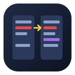
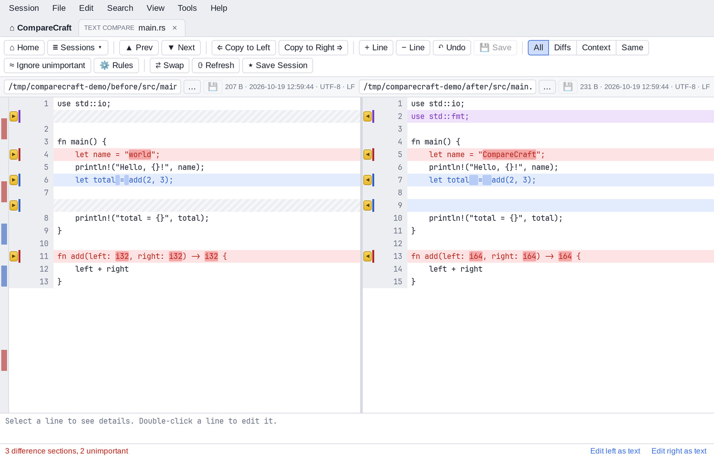
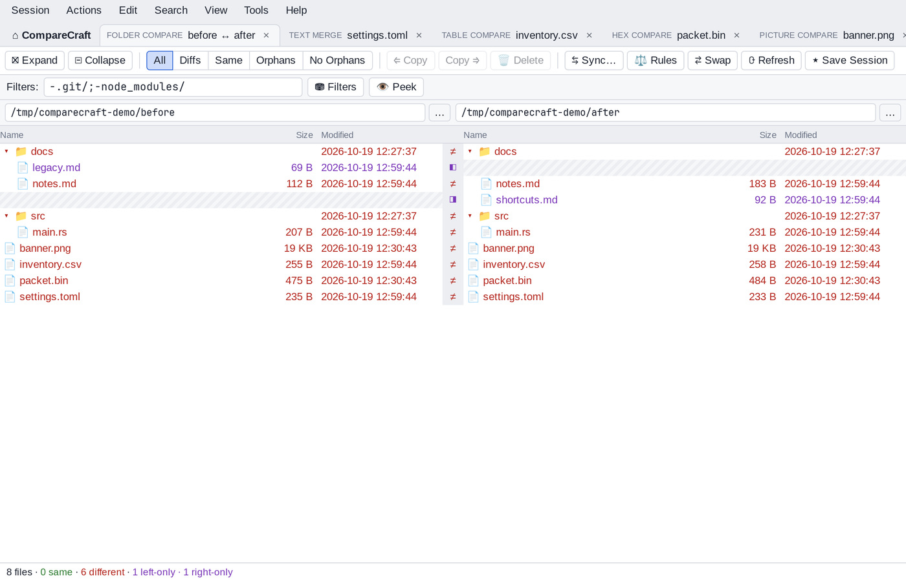
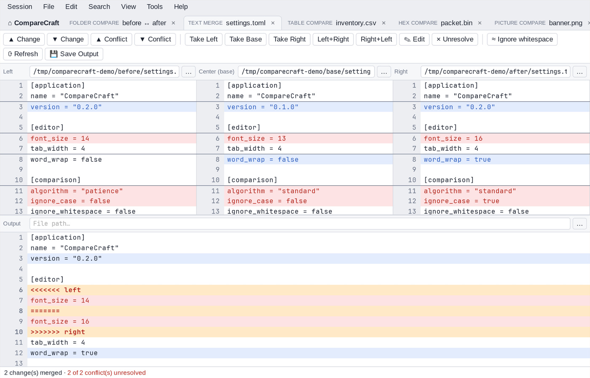
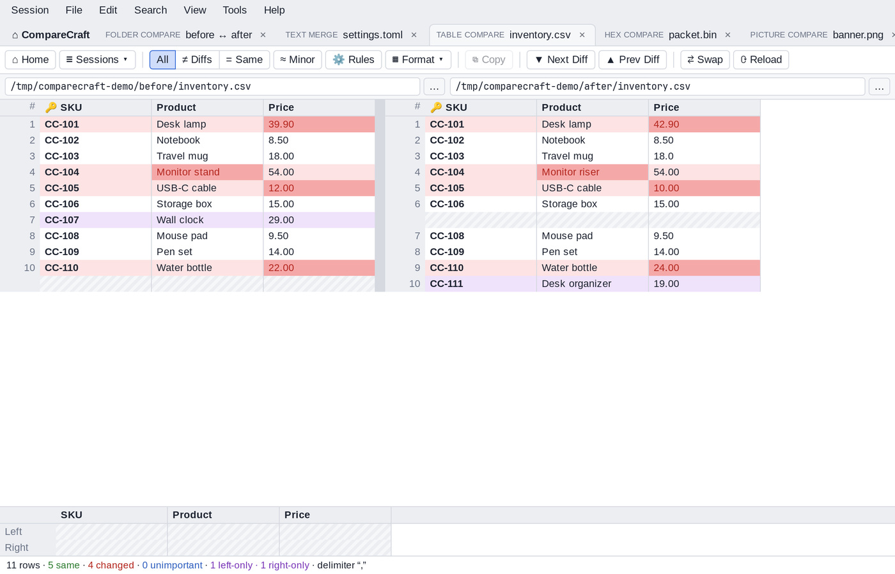
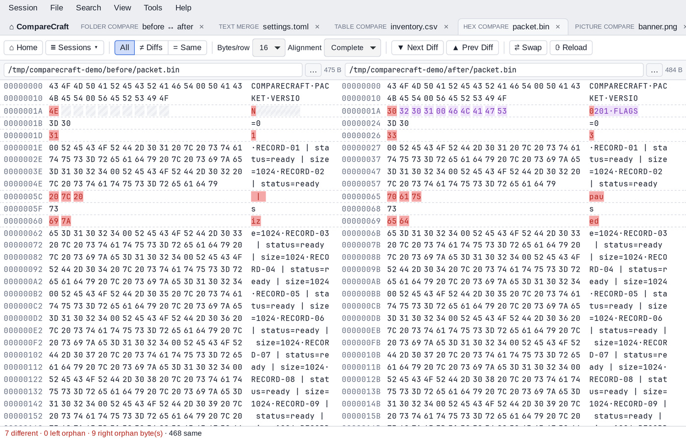
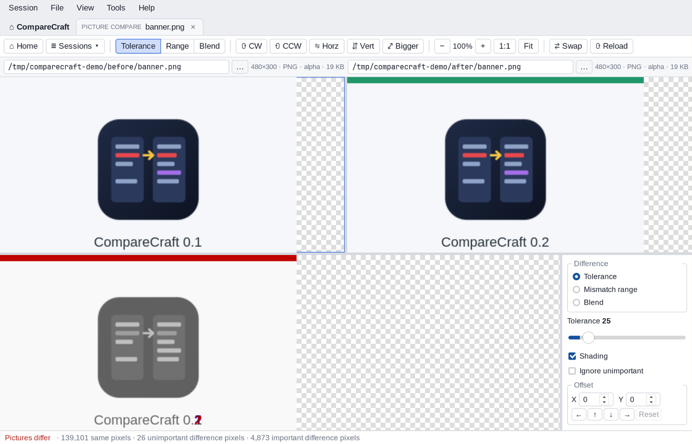
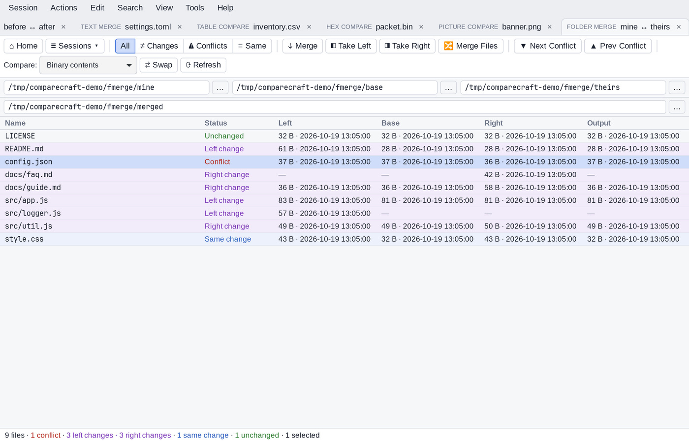
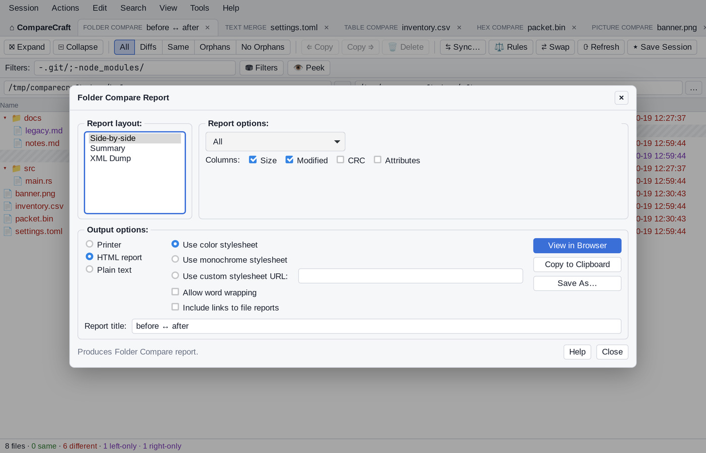
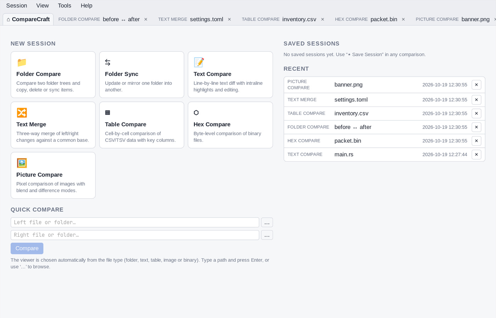

<p align="center">
  
</p>

<h1 align="center">CompareCraft</h1>

<h3 align="center">Compare, merge and synchronize files and folders.</h3>

<p align="center">
  <b>A fast, open-source desktop tool for comparing text, folders, tables, binaries and images, built with Tauri 2, SolidJS and Rust.</b><br>
  Native on Linux, Windows and macOS. Scriptable from the command line. Works as your git diff and merge tool.
</p>

<p align="center">
  <a href="https://github.com/Antebios/comparecraft/actions/workflows/build.yml"></a>
  <a href="https://github.com/Antebios/comparecraft/releases"></a>
  
  
  
  
  <a href="LICENSE"></a>
</p>

<p align="center">
  <a href="#features">Features</a> ·
  <a href="#download">Download</a> ·
  <a href="#build-from-source">Build from source</a> ·
  <a href="#command-line">Command line</a> ·
  <a href="#using-comparecraft-with-git">Git integration</a> ·
  <a href="#keyboard-shortcuts">Shortcuts</a> ·
  <a href="#project-layout">Project layout</a> ·
  <a href="#status-and-roadmap">Roadmap</a>
</p>

<br>

<p align="center">
  
  <br>
  <sub>Text Compare: line alignment, highlighting within lines, and important (red) vs. unimportant (blue) differences.</sub>
</p>

## Features

CompareCraft opens the right view for whatever you give it: two files, two folders, three files to merge, or a saved session.

<table>
<tr>
<td width="50%" valign="top">

### 📝 Text Compare
Side-by-side diff with **Standard** (run-matching with closeness pairing and skew tolerance), **Patience Diff**,
**Myers O(ND)** or **Unaligned** line alignment, an optional *never align differences* mode, and highlighting
of changes within lines.
Differences are classified as **important** (red) or **unimportant** (blue): leading, trailing or embedded
whitespace, case, orphan lines, text **replacements** and sections you mark as **Ignored**. Gutter arrows
copy a section (or the selected lines) to the other side in one click. **Align With** and **Isolate**
fix up the alignment by hand. Edit inline, cut, copy and paste lines, compare a selection to the
clipboard, undo, and save each side on its own or both together. Saves keep the original encoding, BOM
and line endings, and write `.bak` backups.

</td>
<td width="50%" valign="top">

### 🔀 Text Merge
**3-way merge** (left, base, right → output). Non-conflicting changes merge automatically; for each conflict
choose left, right, both or base. The output pane is editable, and conflict navigation takes you from one to
the next.

</td>
</tr>
<tr>
<td width="50%" valign="top">

### 📁 Folder Compare
Recursive tree compare by **timestamp & size**, **size**, **CRC32**, **binary** or **rules-based content**.
A **Filters** bar (`*.rs;-target/`) with history and presets, **Peek** at excluded items, and a
**Session Settings** dialog for comparison rules, name filters, date/size/content filters and alignment
overrides. The **View** menu combines display filters (same, orphans, newer, differences), four folder
handling modes, including **Ignore Folder Structure** (flatten), plus Suppress Filters, columns, legend and a log.
The full **Actions** menu and context menu cover copy or move to the other side or to a folder, delete (to trash or
permanently), rename with masks, attributes, touch, new folder, exclude, align with, compare contents,
file reports and your own **Open With** applications. **Compare To** (F7) marks an item and switches to a
question-mark pointer; click any other file or folder (on either side) to compare the two in a new tab.

</td>
<td width="50%" valign="top">

### 🔄 Folder Sync
Update left → right, right → left or both ways, or **mirror** in either direction. Every action is shown in a
preview before anything runs, and syncing can be limited to the current selection.

### ⑃ Folder Merge
**3-way folder merge** (left, base, right → output folder). Each file is classified as unchanged, a left or right
change, the same change or a conflict. **Merge** (Ctrl+M) copies the changed versions to the output; **Take Left**,
**Take Right** or a per-file **Text Merge** resolve conflicts. Start it from Home, `comparecraft L R BASE OUT`, or
**Session › Merge Base Folders** in Folder Compare.

</td>
</tr>
<tr>
<td width="50%" valign="top">

### 🔢 Hex Compare
Offsets, bytes and an ASCII column with difference navigation. **Alignment** (Complete, Fast or None) lines up
matching data across inserted and deleted bytes, so an insertion shows as a gap instead of a run of differences.

### 📊 Table Compare
CSV/TSV with delimiter auto-detection, a header row, **key columns** for matching rows, and differences
shown cell by cell. Numbers compare by value (`0.10` = `0.1`). **Rules** can make columns, case or whitespace
changes, or numbers within a tolerance *unimportant* (blue); **Minor** treats those as same. All / Diffs /
Same filters, a details pane for the selected row, and copy rows to the clipboard.

</td>
<td width="50%" valign="top">

### 🖼️ Picture Compare
Both pictures above a rendered difference picture. **Tolerance** mode marks unimportant differences blue and
important ones red; **mismatch range** shades by size of difference; **blend** mixes the two. Offset, rotate,
flip, auto-scale, zoom/fit and per-pixel colour details. Reads PNG, JPEG, GIF, BMP, TIFF, WebP, ICO, TGA, PNM,
QOI and (through the webview) SVG/AVIF.

### 💾 Sessions, workspaces & reports
Recent sessions are recorded automatically; **Save Session** / **Save Session As…** name them, **Locked** protects
them and **Clear Session** starts over. Reopen them from Home, the **Sessions** toolbar menu of each compare view,
or with `comparecraft "<session name>"`. **Workspaces** save and restore whole sets of tabs. Every view has an
**Info** summary (Ctrl+I), and **Folder Compare Report…**, **Text Compare Report…** and the other report dialogs
produce side-by-side, summary, interleaved, patch, statistics or XML reports as HTML, plain text or print, the
same reports the `ccomp` console writes. **Compare Parent Folders**, **Merge Base Folders** and **Sync Base Folders**
open related comparisons in one step.

### 🛠️ Tools & Options
**Tools › Options** covers startup and workspace, tabs, colours and fonts, text editing, next-difference
behaviour, backups, file-operation confirmations, keyboard shortcuts, Open With applications and tweaks.
There are also Export/Import Settings, Restore Factory Defaults, folder **snapshots** (`.ccsnap`, usable
in place of a folder), a plain **text editor** and a **patch viewer**.

</td>
</tr>
</table>

CompareCraft runs as a single instance: launching `comparecraft a b` again opens a new tab in the existing window. Light,
dark and auto themes are included.

<table>
<tr>
<td width="50%"><br><sub><b>Folder Compare.</b> Two trees side by side, colour-coded by status.</sub></td>
<td width="50%"><br><sub><b>Text Merge.</b> Left, base and right above an editable output.</sub></td>
</tr>
<tr>
<td width="50%"><br><sub><b>Table Compare.</b> Rows matched by key, differing cells highlighted.</sub></td>
<td width="50%"><br><sub><b>Hex Compare.</b> Aligned bytes and ASCII; an inserted field shows as a gap.</sub></td>
</tr>
<tr>
<td width="50%"><br><sub><b>Picture Compare.</b> Both pictures with a tolerance, range or blend difference picture.</sub></td>
<td width="50%"><br><sub><b>Folder Merge.</b> Three-way merge of folder trees, with conflicts resolved file by file.</sub></td>
</tr>
<tr>
<td width="50%"><br><sub><b>Reports.</b> HTML, plain-text or printed reports from the Session menu.</sub></td>
<td width="50%"><br><sub><b>Home.</b> Start a comparison or reopen a session.</sub></td>
</tr>
</table>

## Documentation

- **User manual:** <https://antebios.github.io/comparecraft/>. It is searchable and covers every view, the
  options, filters, the command line, scripting and reports.
- **In the app:** press **F1** (**Help › CompareCraft Help**) for the same manual, opened at the page for the
  current view, with full-text search (Ctrl+F). **Help › Online Manual** opens the website.
- **Source:** the pages live in [`docs/manual/`](docs/manual/) and are built with [MkDocs](https://www.mkdocs.org/)
  (Material theme) from [`mkdocs.yml`](mkdocs.yml):

  ```sh
  npm run docs:install                 # create .venv-docs and install documentation dependencies
  npm run docs:serve                   # live preview at http://127.0.0.1:8000
  npm run docs:build                   # static site in site/
  ```

  These commands use a project-local Python virtual environment; no activation or system-wide pip install is needed.
  Python 3 with `venv` support is required (`python3-venv` on Debian/Ubuntu).

  [`.github/workflows/docs.yml`](.github/workflows/docs.yml) builds the site whenever the manual changes and publishes it to
  GitHub Pages from `main`.

  **One-time publishing setup:** in the GitHub repository's **Settings > Pages > Build and deployment**, set
  **Source** to **GitHub Actions**, then rerun the docs workflow. A repository administrator must enable Pages;
  the workflow's built-in `GITHUB_TOKEN` cannot enable it automatically.

## Download

Installers for Linux (`.deb`, `.rpm`, AppImage), Windows (`.msi`, NSIS `.exe`) and macOS (`.dmg`, Apple Silicon
and Intel) are published on the [releases page](https://github.com/Antebios/comparecraft/releases).

**Arch / Omarchy:** build and install the package from [`packaging/arch/PKGBUILD`](packaging/arch/PKGBUILD)
(see [below](#linux-packages)). On Omarchy, CompareCraft then appears in the app launcher (Super+Space).

> [!NOTE]
> The downloads aren't code-signed yet. On Windows, if SmartScreen warns you, choose **More info**, then
> **Run anyway**. On macOS, the first time, right-click CompareCraft in Applications and choose **Open**.

## Build from source

### Prerequisites

All platforms need **Rust** (stable, via [rustup](https://rustup.rs)) and **Node.js ≥ 20**.

**Arch / Omarchy / Manjaro**
```sh
sudo pacman -S --needed webkit2gtk-4.1 base-devel curl wget file openssl appmenu-gtk-module libappindicator-gtk3 librsvg
```

**Debian / Ubuntu / Pop!_OS / Mint**
```sh
sudo apt install libwebkit2gtk-4.1-dev build-essential curl wget file libxdo-dev libssl-dev libayatana-appindicator3-dev librsvg2-dev
```

**Fedora**
```sh
sudo dnf install webkit2gtk4.1-devel openssl-devel curl wget file libappindicator-gtk3-devel librsvg2-devel
sudo dnf group install "c-development"
```

**Windows:** Microsoft C++ Build Tools ("Desktop development with C++") and WebView2. WebView2 is preinstalled
on Windows 10 (1803+) and 11.

**macOS:** Xcode Command Line Tools (`xcode-select --install`).

### Develop

```sh
git clone https://github.com/Antebios/comparecraft.git
cd comparecraft
npm install
npm run app:dev                      # hot-reloading app
npm run typecheck                    # TypeScript
npm run test:rust                    # Rust unit tests + text, hex and picture golden suites
npm test                             # typecheck + Rust tests
npm run parity                       # command-line exit-code and merge-output checks (needs a release build)
npm run ccomp -- @script.txt a b     # run the console version (ccomp) from source
```

### Build

```sh
npm run app:build                    # all bundle types for the host OS
npm run app:build:bin                # release binaries (comparecraft, ccomp), no installers
npm run app:build:linux              # deb, rpm, AppImage
npm run app:build:windows            # NSIS, MSI
npm run app:build:macos              # .app, .dmg
```

`npm run tauri -- <args>` passes any other Tauri CLI arguments through.

Installers go to `src-tauri/target/release/bundle/`. The bare binaries are `src-tauri/target/release/comparecraft`
(the application) and `src-tauri/target/release/ccomp` (the [console version](#console-version)).

### Linux packages

- **Arch / Omarchy:**

  ```sh
  npm run package:arch               # or: cd packaging/arch && makepkg -sfi
  ```

  This rebuilds the package from the current checkout, even when an archive with the same version already exists.
  Close any running CompareCraft instances before launching the newly installed version.

- **Desktop entry:** the Arch package installs [`packaging/linux/comparecraft.desktop`](packaging/linux/comparecraft.desktop);
  the `.deb`, `.rpm` and AppImage bundles generate their own.

### Continuous integration

[`.github/workflows/build.yml`](.github/workflows/build.yml) runs the type check and Rust tests on every push
and pull request. Pushing a `v*` tag builds installers for Linux, Windows and macOS (Intel and Apple Silicon)
and attaches them to a draft release.

## Command line

```
comparecraft [options] [left] [right] [center] [output]

comparecraft a.txt b.txt                 # text compare (viewer chosen by file type)
comparecraft dirA dirB                   # folder compare      (-sync for folder sync)
comparecraft mine.txt theirs.txt base.txt out.txt   # 3-way merge
comparecraft -fv="Hex Compare" a.bin b.bin
comparecraft -qc a.txt b.txt; echo $?    # quick compare, no GUI
comparecraft -qc=binary|crc|size a b
comparecraft -automerge [-force] [-iu] [-reviewconflicts] mine theirs base -mergeoutput=out
comparecraft -filters="*.rs;-target/" -expandall dirA dirB
comparecraft "My saved session"
comparecraft @nightly.txt dirA dirB -silent   # run a script without the GUI
comparecraft -cc-select-left a.txt             # stage a file for a later context-menu comparison
comparecraft -cc-compare-staged b.txt           # compare b.txt to the staged left file
comparecraft -cc-compare a.txt b.txt            # compare two selected files
```

Switches use `-name[=value]`; on Windows `/name[=value]` also works. Run `comparecraft -h` for the full list.

### File-manager context menus

On Windows and Linux, **Tools → Options → Startup → File manager integration** adds or removes CompareCraft
actions for the current user. This does not require administrator privileges. Windows registrations are stored in
the current user's Explorer classes; Linux actions are installed for Nautilus (Files), Dolphin and Thunar.
The actions are registered when enabled in Options, not automatically by the app installer.

Enable **Select Left File for Compare** to stage a file, then choose **Compare to Selected Left File** on the
other file. For a direct comparison, select two files and choose **Compare**. Menu labels are static because
file-manager APIs do not provide a shared way to include the staged filename in the action label. The staged
file is saved in the user configuration directory. If it has been moved or deleted, CompareCraft reports that
instead of opening an incorrect pair.

macOS Finder Quick Actions are not currently registered by the Options screen. They can be created per-user in
Automator without administrator privileges:

1. Create a **Quick Action** that receives files in Finder and add **Run Shell Script** with “Pass input: as
   arguments”.
2. For a **Select Left File for Compare** action, use
   `"/Applications/CompareCraft.app/Contents/MacOS/comparecraft" -cc-select-left "$1"`.
3. For a **Compare to Selected Left File** action, use
   `"/Applications/CompareCraft.app/Contents/MacOS/comparecraft" -cc-compare-staged "$1"`.
4. For a **Compare** action that accepts multiple files, use
   `"/Applications/CompareCraft.app/Contents/MacOS/comparecraft" -cc-compare "$@"`.

Adjust the executable path if CompareCraft is installed outside `/Applications`. The staged-left action is
shared across platforms and survives separate Finder invocations. To remove a Quick Action, delete its workflow
from `~/Library/Services`. Quick Action titles are static; macOS does not dynamically include the staged file's
name in the menu item.

### Console version

`comparecraft` is a single-instance GUI program. When CompareCraft is already running, a new comparison opens
as a tab in that window and the command returns immediately. On Windows it has no console, so script and
quick-compare output is not shown.

`ccomp` (`ccomp.exe` on Windows) is the console version and is installed next to `comparecraft`. It takes the
same arguments:

- Scripts (`@script.txt`), `-qc`, `-automerge` and `-h` run inside `ccomp` and print to the console. The exit
  code is the result.
- Any other request opens a new CompareCraft window, and `ccomp` waits until that window is closed. This
  makes it the command to use in batch files, build scripts and version control tools.

```sh
ccomp @nightly.txt dirA dirB              # script output in the console, exit code = result
ccomp -qc a.txt b.txt                     # quick compare
ccomp a.txt b.txt && echo "closed"        # waits for the compare window to close
```

`ccomp` looks for `comparecraft` in its own folder, then on the `PATH`. Set `COMPARECRAFT_GUI` to the
application's path to override this.

Exit codes for quick compare and automerge:

| Code | Meaning |
|---|---|
| 0 | Success |
| 1 | Binary same |
| 2 | Rules-based same (only encoding, BOM or line-ending differences) |
| 11 | Binary differences |
| 12 | Similar (only unimportant differences) |
| 13 | Rules-based differences |
| 14 | Conflicts detected (`-force` output written) |
| 100 | Error (missing or invalid arguments) |
| 101 | Conflicts detected, merge output not written |
| 102 | `ccomp` could not wait for the CompareCraft window to close |
| 103 | `ccomp` could not find or start the CompareCraft application |

## Scripting

A script is a text file with one command per line. Run it with `ccomp @script.txt [params] [-silent]` (or
`comparecraft @script.txt ...`). The GUI does not open, the log is echoed to the console unless `-silent` is
given, and the exit code reports the result.
Commands are case-insensitive, `#` starts a comment and a trailing `&` continues a line. Quote paths that contain
spaces. `%1`..`%9` are the script parameters, and `%date%`, `%time%` and `%fn_time%` expand to the current date
and time. Any other `%NAME%` is replaced by that environment variable.

```text
# nightly.txt: compare two folders, sync newer files and write reports
log verbose "logs/%date%_%fn_time%.txt"
option confirm:yes-to-all
criteria timestamp:2sec size
filter "*.rs;*.toml;-target/" cutoff:<30days
load "%1" "%2"
expand all
folder-report layout:side-by-side options:display-mismatches,column-size output-to:report.html output-options:html-color
select left.newer.files left.orphan.files
copy left->right
sync update:left->right
text-report layout:patch options:patch-unified output-to:changes.diff "%1/README.md" "%2/README.md"
```

| Command | Purpose |
|---|---|
| `log [none\|normal\|verbose] [[append:]file]` | Write a time-stamped log of every command and file operation |
| `load <left> <right>` / `load <session>` / `load <default>` | Load a folder or file comparison (`create:left\|right\|all` creates missing folders) |
| `criteria`, `filter`, `option` | Comparison criteria (`timestamp[:Nsec][;IgnoreDST]`, `size`, `crc`, `binary`, `rules-based`), name masks, `cutoff:`/`size:` filters, `stop-on-error`, `confirm:` |
| `expand`, `collapse`, `select` | Choose folders and items, e.g. `select left.orphan.files`, `select all.diff.files`, `select empty.folders` |
| `compare [crc\|binary\|rules-based]` | Re-compare the selected files |
| `copy`, `move`, `copyto`, `moveto`, `delete`, `rename`, `touch`, `sync`, `snapshot` | File operations on the selection (`rename` accepts masks like `*.bak` or `regexpr <old> <new>`) |
| `folder-report`, `file-report`, `text-report`, `hex-report`, `data-report`, `table-report`, `picture-report` | Plain-text, HTML or XML reports with `layout:`, `options:`, `title:`, `output-to:` (a file, `printer` or `clipboard`) and `output-options:` |

A script name without a folder is also looked up in the `Scripts` folder of the data location.

| Code | Meaning |
|---|---|
| 0 | Script completed |
| 100 | An error occurred and `option stop-on-error` was set |
| 105 | The script file could not be loaded |
| 106 | Unknown command or invalid arguments |
| 107 | A comparison could not be loaded |

## Using CompareCraft with git

```sh
git config --global diff.tool comparecraft
git config --global difftool.comparecraft.cmd 'ccomp "$LOCAL" "$REMOTE"'
git config --global merge.tool comparecraft
git config --global mergetool.comparecraft.cmd 'ccomp "$LOCAL" "$REMOTE" "$BASE" "$MERGED"'
git config --global mergetool.comparecraft.trustExitCode true
```

Then use `git difftool` and `git mergetool` as usual.

## Keyboard shortcuts

Every view has a menu bar (Session / File / Edit / Search / View / Tools / Help; Folder Compare has **Actions** instead
of File). Right-click, the Menu key or Shift+F10 opens the context menu for the selection. Press **F1** for help
on the current view, **Shift+F1** for the full list of shortcuts in the current view, or **F10** to work the menus from the keyboard. On macOS, Ctrl
means ⌘. Shortcuts can be changed in **Tools › Options › Toolbars, Shortcuts**.

| Key | Action |
|---|---|
| Ctrl+T / Ctrl+W / Ctrl+Tab | New tab / close tab / next tab (Shift+Ctrl+Tab: previous tab) |
| Alt+Home, Ctrl+Q | Home view, exit |
| Ctrl+N / Ctrl+P | Next / previous difference (all views) |
| Alt+N / Alt+P | Next / previous conflict (Text Merge) |
| Ctrl+L / Ctrl+R | Copy to left / right (Text and Folder Compare); take left / right (Merge) |
| Shift+Ctrl+L / Shift+Ctrl+R | Copy line (Text Compare); mirror to left / right (Folder Compare) |
| Ctrl+B / Shift+Ctrl+B | Take left then right / right then left (Merge) |
| Ctrl+F, F3, Shift+F3 | Find, find next, find previous |
| Ctrl+G | Go to line (Text) / go to offset (Hex) |
| Alt+↑ / Alt+↓ / Alt+← / Alt+→ | Previous / next existing line, go left / right (Text Compare) |
| F2, Ctrl+Enter, Del | Edit line, insert line, delete line (Text Compare) |
| F7, Ctrl+D, Shift+↑ / Shift+↓ | Align with, select section, extend line selection (Text Compare) |
| Shift+Ctrl+I / Shift+Ctrl+U | Increase / decrease indent (Text Compare) |
| Shift+Ctrl+V, F12 | Open clipboard, save file as (Text Compare) |
| Ctrl+S, Shift+Ctrl+S | Save file, save session |
| Ctrl+Z, Ctrl+Y | Undo, redo |
| F5, Ctrl+F5 | Refresh / reload, full refresh / recompare |
| Enter (Folder Compare) | Open the selected pair, or open/close a single folder |
| F2, Ins, Del, Shift+Del (Folder Compare) | Rename, new folder, delete (to trash), delete permanently |
| F6, F7, Shift+F5 (Folder Compare) | Align with, compare to, refresh selection |
| Alt+← / Alt+→ (Folder Compare) | Back / forward through base-folder history |
| Ctrl+← / Ctrl+→ (Folder Compare) | Act on the left / right side of the selected rows |
| ↑ ↓ PgUp PgDn Home End, ← → (Folder Compare) | Move selection (add Shift to extend it), collapse / expand folder |
| Ctrl+A, Shift+Ctrl+A (Folder Compare) | Select all, select all files |
| Ctrl+Alt+L (Folder Compare) | Legend |
| Ctrl+1 / Ctrl+2 / Ctrl+3 (Folder Compare) | Show all / differences / same |
| Ctrl+1 / Ctrl+2 / Ctrl+3 (Picture Compare) | Tolerance / mismatch range / blend mode |
| F8, Ctrl++ / Ctrl+− / Ctrl+0 (Picture Compare) | Blend toggle, zoom in / out / actual size |

## Data locations

Sessions are stored in `sessions.json` and options in `settings.json` in:

- Linux: `~/.config/comparecraft/`
- macOS: `~/Library/Application Support/comparecraft/`
- Windows: `%APPDATA%\comparecraft\`

Set `COMPARECRAFT_CONFIG_DIR` to use a different folder.

## Project layout

```
index.html           frontend entry point (Vite)
src/                 SolidJS UI: app shell, store, menus, views/*
src-tauri/src/
  fileio.rs          encoding/BOM/EOL detection, safe saves with backups
  align.rs           alignment engine: Standard, Patience, Myers, Unaligned
  diff.rs            importance rules, line status, in-line highlighting
  merge.rs           3-way merge
  quick.rs           -qc quick compare and exit codes
  folder.rs          folder scan, compare criteria, masks, file operations, sync plan/execute
  folder_merge.rs    3-way folder merge classification
  hex.rs             hex compare with byte alignment
  pix.rs             picture decoding, statistics and difference rendering
  table.rs           table compare
  sessions.rs        session persistence
  settings.rs        options file, settings export/import
  snapshot.rs        folder snapshots (.ccsnap)
  shell.rs           file-manager integration (Nautilus scripts, Dolphin service menu)
  cli.rs             argument parsing, automerge
  script.rs          @script runner: commands, selection, file operations, logging
  report.rs          folder, file, text, hex, table and picture reports (text, HTML, XML), used by scripts and the GUI
  lib.rs             Tauri commands, single-instance forwarding
  main.rs            application entry point (comparecraft)
  console.rs         console version (ccomp): headless requests in the console, waits for GUI windows
src/help/            in-app help: renders and searches docs/manual
docs/manual/         user manual (Markdown) and its images, also used by this README
mkdocs.yml           manual website configuration and navigation
packaging/           Arch PKGBUILD, Linux .desktop file
scripts/parity.sh    command-line exit-code and merge-output checks
tests/fixtures/      quick-compare and merge test files
src-tauri/tests/     golden cases for the engines, reports and scripts (fixtures/engine, hex, pix, script)
```

## Status and roadmap

CompareCraft is **early but usable** (version 0.1). Text, merge, folder, sync, hex, table and picture comparison all
work, scripts can run comparisons, file operations and reports without the GUI, and the command-line exit codes are
covered by `scripts/parity.sh`.

Not implemented yet:

- folder merge and three-way folder compare
- source-control integration
- media, registry and version-information compare; picture metadata compare
- archives as folders; FTP/SFTP and cloud locations

Bug reports and pull requests are welcome in [GitHub issues](https://github.com/Antebios/comparecraft/issues).

## License

[MIT](LICENSE) © 2026 CompareCraft contributors

## Trademarks

CompareCraft is an independent project and is not affiliated with, sponsored by, or endorsed by Scooter Software,
Inc. Beyond Compare is a trademark of Scooter Software, Inc.
