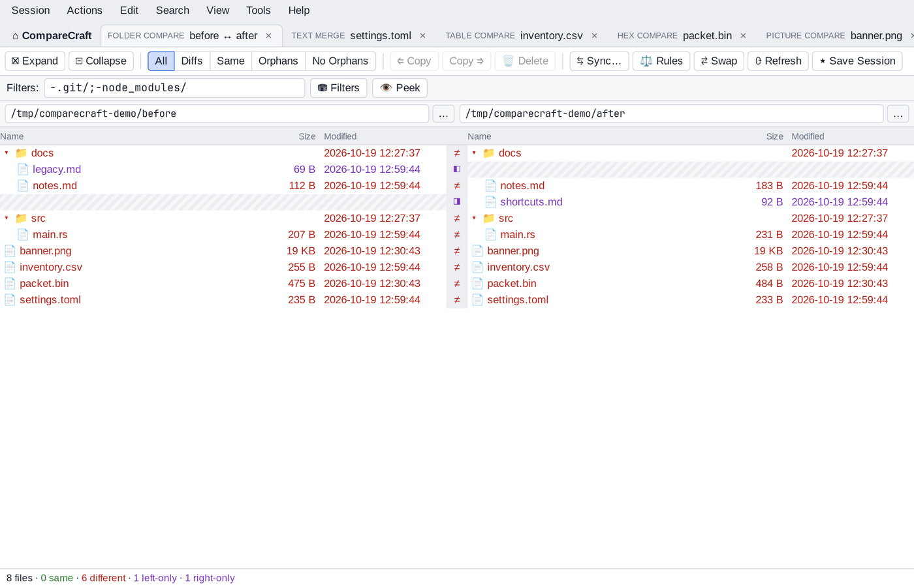

# Folder Compare

Folder Compare shows two folder trees side by side and marks which files and folders are the same, different, or present on one side only. From here you can open file comparisons, copy and move items between the sides, delete, rename and touch files, and synchronize the folders.

## Start a folder comparison

- On the Home view, click the **Folder Compare** card, or choose **Session > New Folder Compare**. Then type a folder path in each path bar and press `Enter`, or click **…** to browse.
- On the Home view, enter two folders under **Quick compare** and click **Compare**.
- From a terminal, run `comparecraft folderA folderB`.

Until both folders are set, the view shows "Choose a left and right folder to compare."

Once both paths are set, a progress strip appears below the path bars. **Scanning folders...** indicates that CompareCraft is discovering the files included by the current filters. Once discovery finishes, the strip shows **Comparing files** and a completed/total file counter, such as **428 / 2,310 files**, with a progress bar.

The counter includes one-sided files; folders themselves are not counted. It measures files processed, not bytes or estimated time remaining, so a large file can take longer than several small files. The strip disappears when the comparison completes or fails. The usual status summary or an error message then shows the outcome.

### In the VS Code extension

Use **CompareCraft: Compare Folder With...** or select two local folders and
choose **Compare Selected in VS Code**. Embedded folder panels reuse the tree,
filters, presets, refresh and file drill-down, but do not provide folder
copy/move/delete/rename/touch, synchronization, folder merge, snapshots or reports.
Use **Open Folder Comparison in Desktop App** for full folder operations.

Folder gutter results reflect saved disk contents, not unsaved editor buffers.
Child text comparisons remain editable; saving or reloading can re-evaluate the
originating disk pair. Presets and named folder sessions are stored separately
from desktop settings. Use **CompareCraft: Open Saved Folder Session...** to
reopen a named extension session. Remote SSH, WSL and Dev Containers are not
supported. See the [extension guide](../../extensions/vscode/README.md) for
helper requirements and limitations.

!!! tip "Snapshots"
    You can enter a snapshot file (`.ccsnap`) instead of a folder on either side. This compares a folder with the state it had when the snapshot was saved. See [Save Snapshot](options.md#save-snapshot).

## The window

From top to bottom, the Folder Compare window has:

- The **toolbar**, with expand and collapse buttons, display filters, comparison presets, copy and delete buttons, Sync, Rules, Swap, Refresh and Save Session.
- The **filter bar**, with the **Filters:** box and the **⛃ Filters** and **👁 Peek** buttons. See [Filters](filters.md).
- The **path bars** for the left and right base folders.
- The **two trees**. Each side has the columns **Name**, **Size** and **Modified**. A narrow status column between the sides shows a symbol for each row.
- The **status bar**, with the number of files and how many are same, similar, different, left-only and right-only (plus errors, if any). When items are selected, it also shows how many are selected on each side.

To hide the Size or Modified column, use **View > Columns**.

## Name sorting

Folders appear before files. By default, dot-prefixed names come first within each group: dot-prefixed folders, other folders, dot-prefixed files, then other files. This is based on the name, not the Windows Hidden attribute, and does not change file filters.

Change **Dot-prefixed names first** under **Tools > Options > Colors, Fonts > Folder views** to set the global default. In **Session Settings > Handling > Sorting**, choose **Use global default**, **First**, or **Alphabetical** for the current comparison. Both panes share the same order. **Alphabetical** uses the existing name sorting, which initially ignores punctuation.

The session choice is retained when saving and reopening a named session. **Use global default** continues to follow global changes. Selecting **Also update session defaults** with **First** or **Alphabetical** also changes the global default; selecting it with **Use global default** leaves the global default unchanged.

## Colors and status symbols

Each row is colored by its comparison result. To see the meaning of the colors at any time, choose **View > Legend** (`Ctrl+Alt+L`).

| Appearance | Status symbol | Meaning |
| --- | --- | --- |
| Red text | ≠ | Different; this side is newer (or no timestamp winner) |
| Grey text | ≠ | Different; this side is older |
| Purple text | ◧ or ◨ | Orphan: exists on this side only (◧ left only, ◨ right only) |
| Blue text | ≈ | Similar: only unimportant differences |
| Normal text | = | Same |
| Error color | ! | Error reading or comparing |
| Ignored style | ◌ | Ignored (treated as same) |

These are the default colors of the light theme. You can change them on the [Colors, Fonts page of the Options](options.md#colors-fonts).

Folders are colored to reflect their content: a folder that contains differences is shown as different. To show folders in plain text instead, turn off **Color folders to reflect content** in the Options. **Alternate row background (stripes)** adds stripes to the rows.

## Expand and collapse folders

- Double-click a folder, or select it and press `Enter`, to expand or collapse it.
- Press `Right` to expand the selected folder. Press `Left` to collapse it, or to go to its parent folder.
- Click **⊞ Expand** or **⊟ Collapse** on the toolbar (or **View > Expand All** and **View > Collapse All**) to expand or collapse the whole tree.
- Right-click selected folders and choose **Open Subfolders** or **Close Subfolders** to expand or collapse everything below them.

To expand folders automatically when a session is loaded, turn on **Expand subfolders when loading session** in [Session Settings](#session-settings). Turn on **Only expand subfolders with differences** as well to expand only the folders that contain differences.

## Select items

- Click a row to select the item on the side you clicked.
- `Ctrl`+click adds items to the selection. `Ctrl`+click on the other side selects the rows on both sides.
- `Shift`+click selects a range of rows.
- Click an empty area to clear the selection.
- Use the arrow keys, `PgUp`, `PgDn`, `Home` and `End` to move the selection. Add `Shift` to extend it.
- `Ctrl+Left` and `Ctrl+Right` select the left or right side of the selected rows.
- **Edit > Select All** (`Ctrl+A`) and **Edit > Select All Files** (`Shift+Ctrl+A`) select everything, or only the files.
- **Edit > Select Newer**, **Edit > Select Orphans** (each with **Left**, **Right** and **Both**) and **Edit > Invert Selection** help you select by status.

Most commands act on the selection, on the side or sides where it is.

## Display filters

Display filters choose which rows are shown, without changing the comparison. The toolbar has five buttons:

| Button | Shows |
| --- | --- |
| All | Every item |
| Diffs | Differences and orphans |
| Same | Items that are the same |
| Orphans | Items that exist on one side only |
| No Orphans | Items that exist on both sides |

The **View > Show** submenu has more combinations: **Show All**, **Show Differences**, **Show Same**, **Show No Orphans**, **Show Differences but No Orphans**, **Show Orphans**, **Show Left Newer**, **Show Right Newer**, **Show Left Newer and Left Orphans**, **Show Right Newer and Right Orphans**, **Show Left Orphans** and **Show Right Orphans**. Press `Ctrl+1`, `Ctrl+2` or `Ctrl+3` for Show All, Show Differences or Show Same.

You can also build your own combination by turning these items on or off in the **View** menu: **Same**, **Left Orphans**, **Right Orphans**, **Left Newer**, **Right Newer** and **Differences (no newer side)**. When a filter other than All is active, its name (or "Custom display filter") appears at the right of the filter bar.

**View > Ignore Unimportant Differences** (on by default) treats items with only unimportant differences as same, both for the display filters and for Next Difference.

## Folder handling modes

The **View** menu has four modes for how folders are shown and compared:

- **Always Show Folders**: every folder is shown, even when none of its items pass the display filter.
- **Compare Files and Folder Structure** (default): folders are shown when they contain matching items, or when they match the display filter themselves (for example orphan folders).
- **Only Compare Files**: folders are shown only when they contain matching files.
- **Ignore Folder Structure**: all files of both trees are compared as if they were in one folder, paired by file name. The filter bar shows "Ignoring folder structure".

## Comparison criteria

By default, files are compared by size and timestamp, with a timestamp tolerance of 2 seconds. To change how files are compared, click **⚖ Rules** on the toolbar, or choose **Session > Session Settings…** and open the **Comparison** tab. See [Session Settings](#session-settings).

To check the contents of some files without changing the criteria, select them and choose **Actions > Compare Contents…**. See [Compare contents](#compare-contents).

## Comparison presets

The comparison split-button provides a faster way to check contents without selecting everything or opening a dialog:

1. Open the arrow beside **Compare All: Rules-based**.
2. Choose **All included files** or **Selected items**, then **CRC**, **Binary**, or **Rules-based**. Choosing an item only changes the button; it does not start comparison.
3. Click the main button to run. Results update the gutter, folder totals, and status bar without opening a results dialog.

**All included files** checks paired files throughout the loaded folder tree, including collapsed folders and items hidden by display filters such as **Diffs** or **Same**. Configured session filters still apply, even when **Peek** or **Suppress Filters** temporarily reveals excluded items. Current counterpart mappings are preserved, including aligned names and flattened folder views. One-sided files keep their orphan status.

**Selected items** uses the existing selection, including descendants of selected folders. It never silently switches to All when nothing is selected. Running either scope does not select all, clear your selection, or change the permanent comparison criteria.

Progress and completion counts appear in the status bar; same, similar, different, and failed comparisons are counted separately. Unreadable files are errors, not differences. Quick presets require two folders with file contents; they do not compare snapshot bytes that are unavailable. Execution buttons are disabled while a comparison is running.

### Named presets and pinned buttons

Choose **Manage Comparison Presets…** from the comparison dropdown or the **Actions** menu to open the preset editor.

- Use **New** or **Duplicate** to create a named preset containing a method and scope. Names must be nonempty and unique, ignoring case.
- Built-in presets cannot be edited or deleted.
- Check **Pin in this folder session** to add a direct-run toolbar button. Extra pins move into **More** when space is limited. Clicking a pin runs that preset without changing the main button's choice.
- **Save** commits editing and pin changes but never runs a comparison. **Cancel** discards the draft.
- Deleting a shared preset asks for confirmation. Sessions referencing deleted presets remove those pins, reset an unavailable active choice to **Compare All: Rules-based**, and report the change.

Named presets form an application-wide library. Each folder session remembers its own active choice and pins. Use **Save Session** to retain those choices in a named session; workspace restoration also retains them. Locked sessions keep their normal Save/Save As protections.

To initialize future folder sessions with the current main-button choice and the edited pins, check **Use the current comparison choice and these pins as defaults for new folder sessions** before saving. Changing a session does not automatically change these defaults.

Presets are not recorded macros: they do not save custom text rules, file filters, paths, or copy/delete operations. Rules-based uses the existing comparison engine behavior.

### Keyboard access and the existing dialog

Tab to the comparison dropdown and press `Down` or `Enter` to open it. Use the arrow keys to navigate, `Enter` to choose, and `Esc` to close and restore focus. The main button and pinned buttons run with `Enter` or `Space`.

The context-menu and **Actions > Compare Contents…** dialog remain available, including their remembered method and **Show results dialog** option. Their preferences are separate from quick presets. The comparison dropdown also links to this dialog when a selection is available.

## Navigate and find

- **Search > Next Difference** (`Ctrl+N`) and **Search > Previous Difference** (`Ctrl+P`) move the selection to the next or previous different or orphan item.
- **Search > Find Filename…** (`Ctrl+F`) finds an item by name. You can enter a name or a mask such as `*.rs`. **Find Next** (`F3`) and **Find Previous** (`Shift+F3`) repeat the search.

What happens when there are no more differences is set on the [Next Difference page of the Options](options.md#next-difference).

## Change the base folders

- Type a new path into a path bar and press `Enter`, or click **…** to browse. **Session > Browse for Folder > Left Side…** or **Right Side…** also browses for a new base folder.
- Select a folder and choose **Set as Base Folder** to make it the new base folder (with a folder selected on each side: **Set as Base Folders**). **Set as Base on Other Side** uses the selected folder as the base of the other side.
- **Session > Up One Level** moves to the parent folder on **Both Sides**, the **Left Side** or the **Right Side**.
- **Session > Back** (`Alt+Left`) and **Session > Forward** (`Alt+Right`) move through the base folders you used before.
- **⇄ Swap** (**Session > Swap Sides**) exchanges the two sides.

## Open file comparisons

- Double-click a file, or select it and press `Enter`, to open the left and right versions in a new tab. CompareCraft chooses the view by file type (see [File Formats](options.md#file-formats)).
- To choose the view yourself, right-click the file and choose **Open With**, then **Text Compare**, **Hex Compare**, **Table Compare** or **Picture Compare**. For folders, **Open With** offers **Folder Compare** and **Folder Sync**.
- Select a folder and choose **Open in New View** to compare that pair of subfolders in a new tab.
- **Open With > Associated Application** opens the file in the program your system uses for it. **Open With > Show in File Manager** (on macOS: **Reveal in Finder**) shows it in your file manager.
- Applications you add on the [Open With page of the Options](options.md#open-with) appear at the end of the **Open With** submenu.

For files present on both sides, the file comparison starts automatically. When it finishes, the originating folder row's status symbol, colors, parent-folder statuses and summary counts update from that result, including for Text, Hex, Table and Picture Compare. This can replace a size/timestamp result with a content-comparison result without changing the folder's comparison settings.

Unsaved text edits do not change the folder result. Saving or reloading the file comparison updates it from the saved content. Refreshing the folder view compares it again using the folder's configured criteria. Comparisons of disjoint items using **Compare To** do not change the original rows.

To check whether two files differ without opening them, select them and choose **Quick Compare**. A message shows the result.

## Compare To

Compare To compares any two items, even if they have different names or are in different folders.

1. Select a file or folder and press `F7` (**Actions > Compare To…**).
2. The status bar shows: "Compare To: click the file to compare “name” with, or press Esc to cancel." The mouse pointer changes to an arrow with a question mark.
3. Click the item to compare with. It can be on either side, but it must be of the same kind (a file for a file, a folder for a folder).

The comparison opens in a new tab. The item from the left side goes on the left.

While Compare To is waiting, the context menu and the **Actions** menu also offer **Compare to name** and, for files, **Compare in Text Compare**, **Compare in Hex Compare**, **Compare in Table Compare** and **Compare in Picture Compare**. To cancel, press `Esc` or choose **Cancel "Compare to name"**.

## Align With

If a file was renamed, it shows up as two orphans: one on each side. **Align With** pairs them so that they are compared with each other.

1. Select the orphan, or select the left orphan and the right orphan (both in the same folder).
2. Press `F6` (**Actions > Align With…**).
3. If you selected one orphan, choose the item to pair it with from the list of unmatched items on the other side, then click **OK**.

To undo the pairing, select the aligned row and choose **Unalign**. All pairings are listed on the **Misc** tab of [Session Settings](#session-settings), where you can delete them.

## Copy and move files

- To copy the selected items to the other side, click **⇐ Copy** or **Copy ⇒** on the toolbar, press `Ctrl+L` (copy to left) or `Ctrl+R` (copy to right), or choose **Copy to Side…** (shown as **Copy to Right…** or **Copy to Left…** when the direction is clear).
- To move items to the other side, choose **Move to Side…**.
- To copy or move items to another folder, choose **Copy to Folder…** or **Move to Folder…**.

The **Copy to Side** and **Move to Side** dialogs show what is selected and let you choose the direction: **Left to right →** or **← Right to left**. Click **Start** to run the operation. In the Copy dialog, **Don't show again** skips the dialog the next time. Moving does not move folders that contain hidden items.

The **Copy to Folder** and **Move to Folder** dialogs ask:

- **From:** **Left side** or **Right side** (when items are selected on both sides).
- The destination folder, with **Browse…**.
- How to keep the folder structure: **Keep relative folder structure**, **Keep base folder structure** or **Don't keep folder structure**.

When a copy would replace an existing file, the **Confirm File Replace** dialog asks "Would you like to replace the existing file … with this one?" Answer **Yes**, **Yes to All**, **No**, **No to All** or **Cancel**.

Confirmations and backups are set on the [File Operations](options.md#file-operations) and [Backups](options.md#backups) pages of the Options.

## Delete files

1. Select the items and press `Del` (or click **🗑 Delete**, or choose **Delete…**).
2. In the dialog, choose which sides to delete from (**Left side**, **Right side**).
3. Leave **Use recycle bin if possible** on to move the items to the trash, or turn it off to delete them permanently.
4. Click **Delete**.

`Shift+Del` (**Delete Permanently**) deletes without using the trash.

## Rename files

1. Select the items and press `F2` (**Rename…**).
2. Choose **DOS compatible** to rename with wildcard masks, or **Regular expressions** to rename with a pattern.
3. Enter the **Old mask** and **New mask** (or the **Old pattern** and **New pattern**). The dialog shows a live preview of the new names.
4. Click **Start**.

## Change attributes

Choose **Attributes…** to change the permissions of the selected items. Check a box to set an attribute and uncheck it to clear it. Greyed boxes are left unchanged.

- On Linux and macOS, there are **Read**, **Write** and **Execute** boxes for the owner, the group and others, and a **Permissions (octal):** box.
- On Windows, there is a **Read-only** box.

## Touch files

**Touch…** changes the modified time of the selected items:

- Choose the sides (**Left side**, **Right side**), and turn on **Including folder contents** to touch everything inside selected folders.
- **Copy timestamps from other side** gives each item the timestamp of its counterpart.
- **Set timestamps to →** sets a date and time you choose. The **Default:** buttons fill in the **Current system time** or the **Last touch** time.

## Create folders

Press `Ins` (**New Folder…**), enter a **Name:** (default "New Folder") and click **OK**. The folder is created inside the selected folder if it is expanded, otherwise next to the selected item. With nothing selected, it is created in the base folder of the side you clicked.

## Exclude items

**Exclude** removes the selected items from the comparison by adding them to the session's file filters. When all selected files have the same extension, **Exclude…** opens a dialog where you can exclude:

- **Selected filename** (or **Selected filenames**), or **All .ext file types** (for files without an extension: **All files without an extension**).
- **Only in this folder**, to exclude them in this folder only.
- **Don't show again during this session**, to skip the dialog next time.

To see excluded items again, use **👁 Peek** or edit the filters. See [Filters](filters.md).

## Other commands

- **Copy Filename** copies the full paths of the selected items to the clipboard.
- **Ignored** marks the selected items as ignored: they are treated as same and shown with ◌. Choose it again to remove the mark.
- **Refresh Selection** (`Shift+F5`) compares the selected items again.
- **Edit > Refresh** (`F5`, or **⟳ Refresh** on the toolbar) compares both folders again. **Edit > Full Refresh** (`Ctrl+F5`) also clears the Ignored marks.
- **View > Log** shows a log of the operations and messages of this view. Click **Clear** to empty it.

## Compare contents

Select files and choose **Compare Contents…** to compare their contents with their counterparts:

- **CRC comparison** compares checksums.
- **Binary comparison** compares the files byte by byte.
- **Rules-based comparison** (default) compares the files as text, using the comparison rules, so files that differ only in unimportant ways count as similar.

With **Show results dialog** on, a list shows the **Result** for each **File**: Binary same, Same, Binary differences, Unimportant differences, Important differences or Error. Double-click a file in the list to open it.

## File compare report

Select one or more files and choose **File Compare Report…** (on the **Actions** menu and the context menu). If all selected files are of the same type, the report dialog of that viewer opens, for example **Text Compare Report**. Otherwise the **File Compare Report** dialog reports each file with the viewer for its type. See [Create reports in the application](reports.md#create-reports-in-the-application).

## Session menu commands

- **Folder Compare Info** (`Ctrl+I`) shows how many files are same, orphans, newer or different. Expand a category to list its files.
- **Folder Compare Report…** creates a report of the comparison as shown, with the expanded folders, filters and columns of the view. See [Reports](reports.md#create-reports-in-the-application).
- **Compare Parent Folders** compares the folders that contain the two base folders, in a new tab.
- **Merge Base Folders** opens the two base folders in a [Folder Merge](folder-merge.md).
- **Sync Base Folders** opens the two base folders in a [Folder Sync](folder-sync.md). In Folder Sync this command is **Compare Base Folders** and opens a Folder Compare.
- **Save Session**, **Save Session As…**, **Locked** and **Clear Session** (`Shift+Ctrl+C`) are described in [Sessions](sessions.md).

## Synchronize folders

Click **⇆ Sync…** on the toolbar, or choose a command from **Actions > Synchronize**: **Update Right…**, **Update Left…**, **Update Both…**, **Mirror to Right…** (`Shift+Ctrl+R`) or **Mirror to Left…** (`Shift+Ctrl+L`). See [Folder Sync](folder-sync.md).

## Context menus

Right-click a row (or press the Menu key or `Shift+F10`) to open the context menu for the selection. It contains the commands of the **Actions** menu that apply to the selected items.

Right-click the empty area below the rows for **Refresh**, **Full Refresh**, **New Folder**, **Select All**, **Expand All**, **Collapse All** and **Legend**.

## Session settings

Choose **Session > Session Settings…** to open the **Folder Compare - Session Settings** dialog. The **⚖ Rules** button opens it on the Comparison tab, and **⛃ Filters** on the Name Filters tab.

### Specs

- **Left folder:** and **Right folder:**, each with **Browse…**. **⇅ Swap** exchanges them; **↓ Copy** and **↑ Copy** copy one path to the other. A snapshot file (`.ccsnap`) can be used in place of a folder.
- **Description**: a free-text note for the session.

### Comparison

Quick tests:

- **Compare file size**: always on.
- **Compare timestamps**, with a **tolerance** in seconds (2 by default). Turn this off to compare by size only.
    - **Ignore daylight saving time differences**: timestamps exactly one hour apart count as equal.
    - **Ignore timezone differences**: timestamps a whole number of hours apart (up to 24) count as equal.
- **Compare filename case**: when on, names that differ only in case are treated as different items. By default it is off on Windows and macOS and on on Linux.

Requires opening files:

- **Compare contents**, using **CRC comparison**, **Binary comparison** or **Rules-based comparison**.

Options shown greyed out are not supported yet.

### Handling

- **Expand subfolders when loading session**, and **Only expand subfolders with differences**.
- **Follow symbolic links** (off by default).
- **Automatic refresh every N seconds**: refreshes the comparison automatically (at least every 5 seconds).

Archives are always compared as files.

### Name Filters and Other Filters

These tabs set which files and folders are included in the comparison. See [Filters](filters.md).

### Misc

- **Alignment overrides**: the pairs created with Align With, with **Delete** and **Delete All** buttons.
- **Name filter presets**: the list of presets offered in the Filters box.

### Applying the settings

At the bottom of the dialog, choose where the changes apply:

- **Use for this view only**.
- **Also update session defaults**: new folder comparisons start with these settings.
- **Also update saved session**: also stores the settings in the saved session (only for sessions saved by name).

Then click **OK** or **Apply**.

## Save the session

Click **★ Save Session** or press `Shift+Ctrl+S` to save this comparison, including its settings and filters, under a name. **Session > Save Session As…** saves it under another name. See [Sessions](sessions.md).
