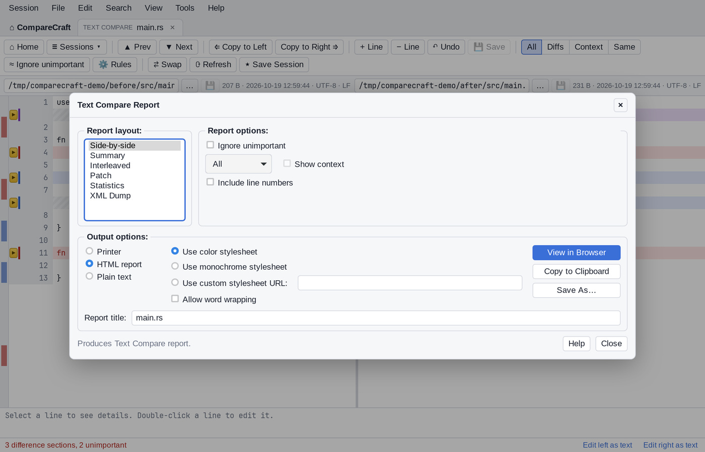
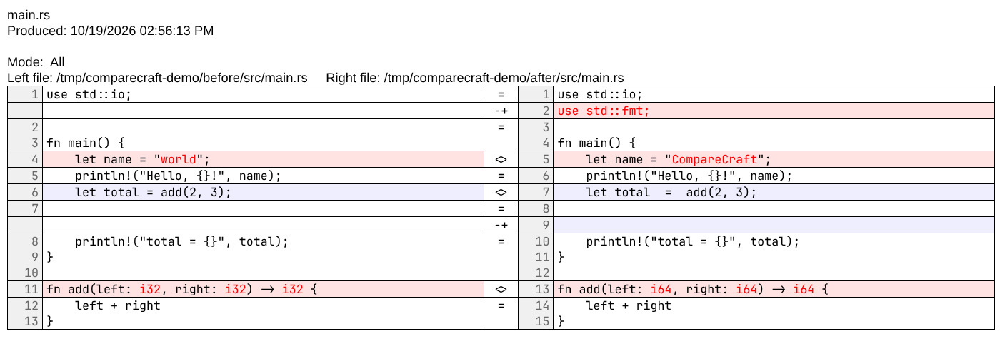
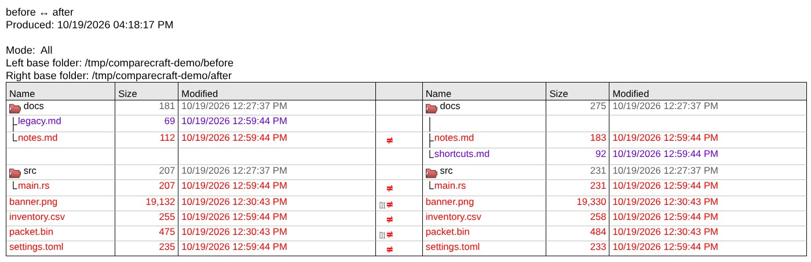

# Reports

CompareCraft writes reports of folder and file comparisons: plain text for logs and e-mail, HTML for browsers, patch files for other tools, CSV statistics and XML for further processing. You can create them from the application window or with script commands. This page describes both, with every layout and option, and shows sample output.

## Create reports in the application

Folder Compare and the file comparison views have a report command on the **Session** menu: **Folder Compare Report…**, **Text Compare Report…**, **Table Compare Report…**, **Hex Compare Report…** and **Picture Compare Report…**. In Folder Compare, select one or more files and choose **Actions > File Compare Report…** (also on the context menu) to report on the selected files instead.

The report dialog has three parts.


**Report layout** lists the layouts for the view:

| Dialog | Layouts |
|---|---|
| Folder Compare Report | Side-by-side, Summary, XML Dump |
| Text Compare Report | Side-by-side, Summary, Interleaved, Patch, Statistics, XML Dump |
| Table Compare Report, Hex Compare Report | Side-by-side, Summary, Interleaved |
| Picture Compare Report | Side-by-side, Summary |
| File Compare Report | Side-by-side, Summary, Interleaved |

File Compare Report uses the viewer-specific dialog when all selected files are of the same type, for example Text Compare Report for text files. Otherwise each file is reported with the viewer for its type.

**Report options** change with the view and the layout:

- A display filter: **All**, **Differences**, **Same** or **None**. In folder reports it offers the same filters as the Folder Compare toolbar, such as **Orphans** or **Left Newer**.
- For file reports: **Ignore unimportant**, and **Show context** (with **Differences**).
- **Include line numbers** (text, side-by-side), **Include byte addresses** (hex) or **Include row numbers** (table).
- For the Interleaved layout: **Strikeout left differences** and **Strikeout right differences**.
- For the Patch layout: **Patch style:** **Normal diff**, **Context diff** or **Unified diff**.
- For folder reports: **Columns:** **Size**, **Modified**, **CRC** and **Attributes**.



**Output options** choose where the report goes:

- **Printer**, with **Difference highlighting:** (**Use color** or **Monochrome**) and **Wrap lines:** (**No wrap**, **Wrap words** or **Wrap characters**). Click **Print Preview** to see the report first, or **Print…** to print it.
- **HTML report**, with **Use color stylesheet**, **Use monochrome stylesheet** or **Use custom stylesheet URL:**, and **Allow word wrapping**. Folder reports can also **Include links to file reports**. Click **View in Browser** to open the report in your web browser.
- **Plain text**. In Text Compare Report, the Patch, Statistics and XML Dump layouts are always plain text.

For HTML and plain text, click **Copy to Clipboard** or **Save As…**. **Report title:** sets the title on the first line of the report; it starts as the tab title.

The report shows the comparison as it is on screen:

- Folder reports include the files of expanded folders only, and use the current comparison criteria and filters.
- Text reports include edits that have not been saved, and use the current comparison rules.

CompareCraft remembers the last settings of each report dialog.

## Create reports with scripts

Script commands create the same reports without opening a window (see [Scripting](scripting.md)):

```sh
ccomp @report.txt old new
```

```text
# report.txt
load "%1" "%2"
expand all
folder-report layout:side-by-side options:display-mismatches output-to:folders.html output-options:html-color
```

## Report commands

| Command | Reports on |
|---|---|
| `folder-report` | The loaded folder comparison. Lists the files and folders, their sizes and dates, and whether they match. |
| `file-report` | File comparisons. Each file is reported with the viewer for its type: text, table, hex or picture. |
| `text-report` | File comparisons as text, line by line. |
| `hex-report` | File comparisons byte by byte. |
| `table-report`, `data-report` | File comparisons of CSV or other delimited files, cell by cell. |
| `picture-report` | Picture comparisons, pixel by pixel. |

The file report commands (`file-report` and the four viewer-specific commands) can report on:

- two files given at the end of the command, for example `text-report output-to:diff.txt a.txt b.txt`;
- a saved session given by name;
- the loaded pair of files, if `load` was used with two files;
- all files selected in the loaded folder comparison, in one report.

`folder-report` always reports on the loaded comparison. It does not take paths, so `load` the folders first. It lists only the contents of expanded folders, so run `expand all` first if you want every file in the report.

## Report arguments

All report commands take the same arguments. They can be given in any order:

```text
<command> [layout:<layout>] [options:<option>,<option>,...] [title:<title>] output-to:<destination> [output-options:<option>,...] [<left> <right>]
```

| Argument | Description |
|---|---|
| `layout:` | How the report is arranged. See [Layouts](#layouts). |
| `options:` | Comma-separated list of what to include. See [Options](#options). |
| `title:` | Report title, shown on the first line (and as the page title in HTML). The default is the viewer name, for example `Text Compare` or `Folder Compare`. |
| `output-to:` | Where the report goes. Required. See [Output destinations](#output-destinations). |
| `output-options:` | Comma-separated output format options. See [Output options](#output-options). |

Values with spaces must be quoted, for example `title:"Release 2.0 changes"`.

## Layouts

| Layout | Text | Table | Hex | Picture | Folder |
|---|---|---|---|---|---|
| `side-by-side` (default) | yes | yes | yes | yes | yes |
| `interleaved` | yes | yes | yes | yes | no |
| `summary` | yes | yes | yes | yes | yes |
| `patch` | yes | no | no | no | no |
| `statistics` | yes | no | no | no | no |
| `xml` | yes | no | no | no | yes |

- **side-by-side** shows the left and right content in two columns, with a marker between them for each line or row.
- **interleaved** shows the left lines followed by the matching right lines, one above the other. This is useful for long lines.
- **summary** shows counts instead of content: matching and different lines, rows, bytes or pixels for files; groups of orphan, newer and different files for folders.
- **patch** writes a patch file that can be applied with the standard `patch` tool. The normal diff format is used, unless you give `patch-unified` or `patch-context`.
- **statistics** writes comma-separated values with the number of original, added, deleted and changed lines.
- **xml** writes the comparison in XML for processing by other tools.

Notes on layouts:

- `patch`, `statistics` and `xml` for text work only when the two files are given on the report command itself. For a loaded file pair or for files selected in a folder comparison, they produce a side-by-side report instead.
- For picture comparisons in plain text, `summary` gives pixel counts and the other layouts give only the report header. Use HTML output to see the picture differences.
- An unknown layout name gives a side-by-side report.

## Options

Give options as a comma-separated list after `options:`, for example `options:display-mismatches,line-numbers`.

### Options for file reports

| Option | Description |
|---|---|
| `display-all` | Show all lines (default). |
| `display-mismatches` | Show only the differences. |
| `display-context` | Show the differences with a few matching lines of context around each one. Not available for `hex-report`. |
| `display-matches` | Show only the matching lines. |
| `ignore-unimportant` | Treat unimportant differences as matches. Unimportant differences are changes in case, whitespace and blank lines. |
| `line-numbers` | Show line numbers (text), row numbers (table) or byte offsets (hex) in side-by-side reports. Interleaved reports always show line numbers. |
| `patch-unified` | With `layout:patch`: unified diff format (`---`/`+++`, `@@` hunks), with 3 lines of context. |
| `patch-context` | With `layout:patch`: context diff format (`***`/`---`), with 3 lines of context. |
| `strikeout-left-diffs` | HTML interleaved text reports: different text on the left is shown struck out. |
| `strikeout-right-diffs` | HTML interleaved text reports: different text on the right is shown struck out. |
| `stats-descriptive` | Not available. The report is written as a `summary` instead, and the script prints `STATS-DESCRIPTIVE report is unavailable.  Switching to SUMMARY report.` |

If several `display-` options are given, the last one wins.

### Options for folder reports

These options choose which items are listed:

| Option | Items shown | Mode shown in the report |
|---|---|---|
| `display-all` | All items (default) | All |
| `display-mismatches` | Orphans, newer and different files | Differences |
| `display-no-orphans` | Everything except orphans | No Orphans |
| `display-mismatches-no-orphans` | Newer and different files | Differences but No Orphans |
| `display-orphans` | Orphans on either side | Orphans |
| `display-left-newer` | Files that are newer on the left | Left Newer |
| `display-right-newer` | Files that are newer on the right | Right Newer |
| `display-left-newer-orphans` | Left newer files and left orphans | Left Newer and Left Orphans |
| `display-right-newer-orphans` | Right newer files and right orphans | Right Newer and Right Orphans |
| `display-left-orphans` | Items that exist only on the left | Left Orphans |
| `display-right-orphans` | Items that exist only on the right | Right Orphans |
| `display-matches` | Matching files | Same |

These options choose the columns:

| Option | Column |
|---|---|
| `column-size` | Size in bytes |
| `column-timestamp` | Modification date and time |
| `column-crc` | CRC checksum, when it has been calculated (for example with `criteria crc`) |
| `column-attributes` | File attributes, for example `-rw-r--r--` on Linux and macOS |

- Without any `column-` option, the report shows Size and Modified.
- When you give `column-` options, only those columns are shown, always in the order Size, CRC, Modified, Attributes.

`include-file-links` adds a link from each file in an HTML side-by-side folder report to a separate report of that file's comparison. See [HTML reports](#html-reports).

## Output destinations

| Value | Destination |
|---|---|
| `output-to:<file>` | Writes the report to a file. Relative paths are resolved against the current directory, and missing folders are created. An existing file is replaced. |
| `output-to:clipboard` | Copies the report to the clipboard. On Linux this needs `wl-copy`, `xclip` or `xsel` to be installed. |
| `output-to:printer` | Sends the report to the default printer (`lp` or `lpr` on Linux and macOS, Notepad on Windows). Use plain-text reports for printing. |

If the report cannot be written, the script prints a script error and continues, unless `option stop-on-error` is set.

## Output options

| Option | Description |
|---|---|
| (none) | Plain text. |
| `html-color` | HTML with colours. |
| `html-mono` | HTML in black and white. |
| `html-custom=<URL>` | HTML that links to your own style sheet at `<URL>` instead of the built-in one. |
| `wrap-word` | HTML only: long lines wrap within their cell. Without it, lines are not wrapped. |

Combine them with commas, for example `output-options:html-color,wrap-word`. XML reports ignore the HTML options.

```text
text-report output-to:report.html output-options:"html-custom=https://intranet.example.com/styles/diff.css" old.txt new.txt
```

## HTML reports

An HTML report is a single HTML file with the style sheet embedded in it, so it can be opened in any browser, attached to an e-mail or published as a build artifact. With `html-custom=`, the file links to your style sheet instead.

A side-by-side text report with the color style sheet and line numbers:



A side-by-side folder report with the color style sheet, after `expand all`:



When the comparison criteria compared file contents (`binary`, `crc` or `rules-based`), the center column of a side-by-side folder report shows the result of each content comparison as an icon:

| Icon | Meaning |
|---|---|
| `01` and `=` | The files are binary identical |
| `=` | The files match by the comparison rules but are not binary identical, for example different line endings |
| `≈` | The files differ only in unimportant text |
| `≠` | The files differ |
| `01` and `≠` | The files differ byte for byte (binary criteria, or binary content with rules-based criteria) |

With `criteria timestamp size` no contents are compared and the column stays empty. With `html-mono`, the icons are drawn in shades of gray.

Some reports need images or additional pages. These are written to folders next to the report file:

| Folder | Contents |
|---|---|
| `BcImages/` | Tree lines, folder icons and content comparison icons used in folder reports, and the difference images of picture reports. Only the icons a report uses are written. |
| `BcFiles/` | With `include-file-links`: one HTML page for each file comparison linked from a folder report. These pages have their own `BcImages/` folder inside `BcFiles/`. |

When copying or publishing an HTML report, copy these folders along with it. For example, this script:

```text
load left right
expand all
folder-report options:display-mismatches,include-file-links output-to:out/folder.html output-options:html-color
```

creates:

```text
out/folder.html
out/BcImages/            (tree, folder and content images)
out/BcFiles/             (one page per linked file comparison)
out/BcFiles/BcImages/
```

Summary, patch and statistics reports in HTML always use the black-and-white style.

## Sample text report

A side-by-side text report with `options:display-all,line-numbers`:

```text
text-report layout:side-by-side options:display-all,line-numbers output-to:main.txt left/src/main.rs right/src/main.rs
```

```text
Text Compare
Produced: 10/19/2026 12:52:54 AM

Mode:  All
Left file: /home/me/project/left/src/main.rs     Right file: /home/me/project/right/src/main.rs
1 fn main() {                =  1 fn main() {
---------------------------------------------------------------
2     println!("Hello");     <> 2     println!("Hello, world");
---------------------------------------------------------------
3     let x = 1;             =  3     let x = 1;
4     let y = 2;                4     let y = 2;
5     println!("{}", x + y);    5     println!("{}", x + y);
---------------------------------------------------------------
                             -+ 6     println!("done");
---------------------------------------------------------------
6 }                          =  7 }
---------------------------------------------------------------
```

The markers between the columns are:

| Marker | Meaning |
|---|---|
| `=` | The lines match |
| `<>` | The lines differ |
| `+-` | The line exists only on the left |
| `-+` | The line exists only on the right |

The same comparison with `layout:summary`:

```text
5 same line(s)
1 important right orphan line(s)
1 important difference line(s)

2 difference section(s)
```

With `options:ignore-unimportant`, differences in case or whitespace are counted as `ignored unimportant difference line(s)` instead.

With `layout:interleaved options:display-mismatches`:

```text
2       println!("Hello");
  2     println!("Hello, world");
---------------------------------
---------------------------------
  6     println!("done");
---------------------------------
```

With `layout:patch options:patch-unified`:

```text
--- /home/me/project/left/src/main.rs	2026-10-01 09:00:00.000000000 
+++ /home/me/project/right/src/main.rs	2026-10-05 14:30:00.000000000 
@@ -1,6 +1,7 @@
 fn main() {
-    println!("Hello");
+    println!("Hello, world");
     let x = 1;
     let y = 2;
     println!("{}", x + y);
+    println!("done");
 }
```

With `layout:statistics`:

```text
Text Compare
Produced: 10/19/2026 12:59:48 AM
SourceFile,CompareFile,IOriginal,IAdded,IDeleted,IChanged,UOriginal,UAdded,UDeleted,UChanged,SourceError,CompareError,Error
/home/me/project/left/src/main.rs,/home/me/project/right/src/main.rs,6,1,0,1,0,0,0,0
```

The `I` columns count important lines and the `U` columns count unimportant lines.

## Sample folder report

A side-by-side folder report after `expand all`, with `options:display-all`:

```text
Folder Compare
Produced: 10/19/2026 12:52:54 AM

Mode:  All
Left base folder: /home/me/project/left
Right base folder: /home/me/project/right
Name       Size Modified                  Name       Size Modified
--------------------------------------------------------------------------------
docs         23 10/05/2026 02:30:00 PM    docs         28 10/05/2026 02:30:00 PM
|                                      << +new.txt      9 09/20/2026 08:00:00 AM
+notes.md    19 09/20/2026 08:00:00 AM =  \notes.md    19 09/20/2026 08:00:00 AM
\old.txt      4 09/20/2026 08:00:00 AM >>
src         142 10/05/2026 02:30:00 PM    src         171 10/05/2026 02:30:00 PM
+lib.rs      48 09/20/2026 08:00:00 AM =  +lib.rs      48 09/20/2026 08:00:00 AM
\main.rs     94 10/01/2026 09:00:00 AM << \main.rs    123 10/05/2026 02:30:00 PM
Cargo.toml   30 10/01/2026 09:00:00 AM << Cargo.toml   30 10/05/2026 02:30:00 PM
--------------------------------------------------------------------------------
```

| Marker | Meaning |
|---|---|
| `=` | The files match |
| `<>` | The files differ, including files that differ only in unimportant text |
| `>>` | The left file is newer, or the item exists only on the left |
| `<<` | The right file is newer, or the item exists only on the right |

The `+`, `\` and `|` characters in front of names draw the folder tree; a `|` on a side where an item is missing continues the line to that side's next item. Sizes use thousands separators, for example `3,222,473`. If filters are in effect, the report header has a `Filters:` line describing them.

The same comparison with `layout:summary options:display-mismatches` lists the items in groups:

```text
Folder Compare
Produced: 10/19/2026 12:52:54 AM

Mode:  Differences
Left base folder: /home/me/project/left
Right base folder: /home/me/project/right

Left Orphan Files (1)  Size Modified
--------------------------------------------------
docs/old.txt              4 09/20/2026 08:00:00 AM
--------------------------------------------------

Right Orphan Files (1) Size Modified
--------------------------------------------------
docs/new.txt              9 09/20/2026 08:00:00 AM
--------------------------------------------------

Left Newer Files (0)   Size Modified
--------------------------------------------------

Right Newer Files (2)  Size Modified
--------------------------------------------------
src/main.rs              94 10/01/2026 09:00:00 AM
                        123 10/05/2026 02:30:00 PM
Cargo.toml               30 10/01/2026 09:00:00 AM
                         30 10/05/2026 02:30:00 PM
--------------------------------------------------

Difference Files (0)   Size Modified
--------------------------------------------------
```

For newer files, the first line shows the left file and the second line the right file.

## Notes and limitations

- `folder-report` reports on the loaded comparison only. Paths after the command are an error (`Unexpected argument(s)`, exit code 106). Use `load` first.
- `hex-report` does not accept `display-context` (exit code 106).
- `stats-descriptive` is not available and gives a `summary` report instead, with a message in the console and log.
- A report command without `output-to:` is an error (`Report requires output-to`, exit code 106).
- Folder reports and selections include only items inside expanded folders.
