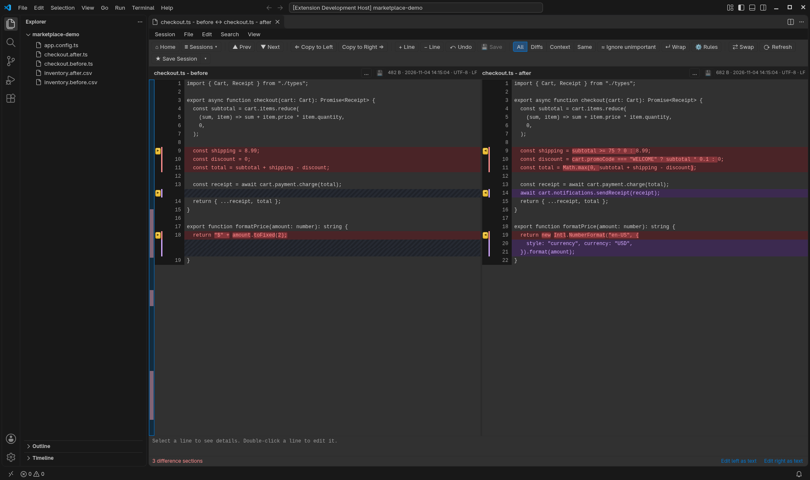
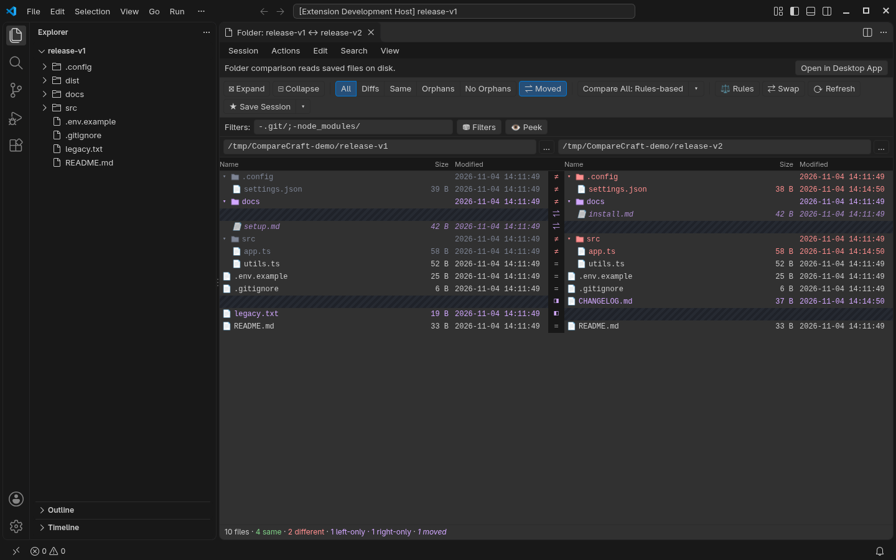
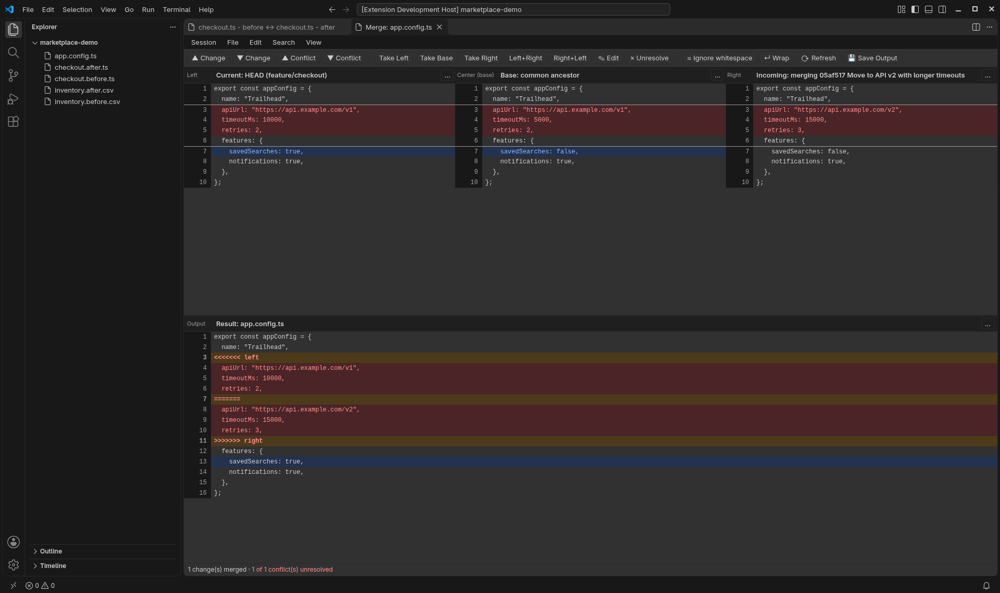
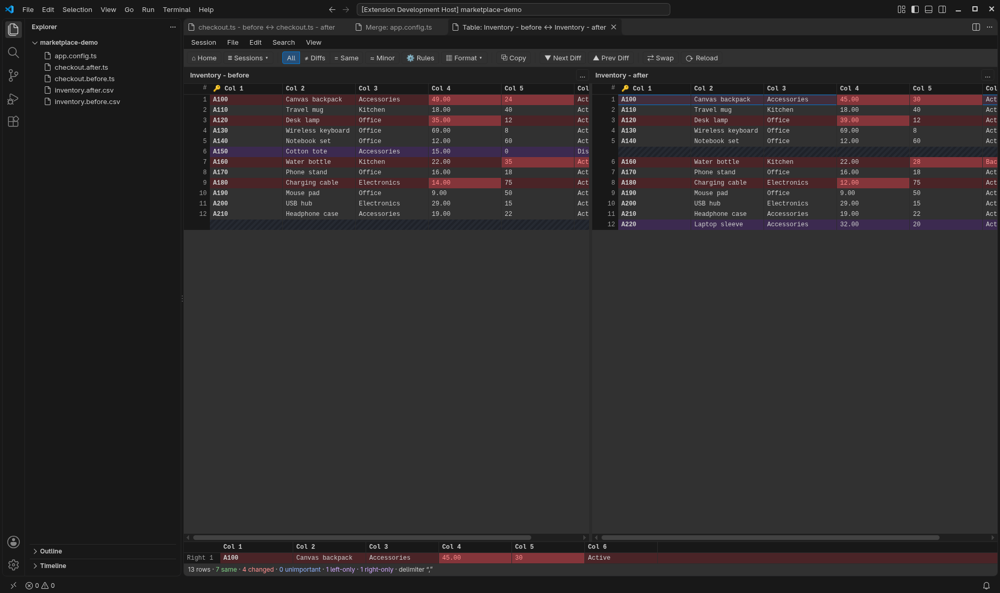

# CompareCraft for VS Code

The CompareCraft extension compares files, folders, editor text and Git
revisions in VS Code tabs, and resolves three-way Git conflicts. It works in
VS Code on your computer, in remote windows (Remote - SSH, WSL, Dev Containers),
in Restricted Mode, in virtual workspaces and in VS Code for the Web. The
CompareCraft desktop app is optional; the extension can also open comparisons
in it.

## Requirements

- VS Code 1.95 or newer.
- The extension package for your platform (Windows, macOS, Linux and Alpine
  Linux; x64 and Arm64). It includes CompareCraft's comparison helper. On other
  platforms, the universal package compares files with CompareCraft's
  WebAssembly engine.
- Optional: the CompareCraft desktop app, to open comparisons in its own window
  and for folder operations such as copying, synchronizing and merging folders.
- Git, for Git comparisons and conflict resolution.

## Install

1. Download the package for your platform from the
   [CompareCraft releases page](https://github.com/Antebios/comparecraft/releases):
   `comparecraft-<version>-<platform>.vsix`, for example
   `comparecraft-1.2.3-win32-x64.vsix`, `comparecraft-1.2.3-darwin-arm64.vsix`
   or `comparecraft-1.2.3-linux-x64.vsix`. Other platforms use
   `comparecraft-<version>.vsix`.
2. In VS Code, open **Extensions** (`Ctrl+Shift+X`), select **…**, choose
   **Install from VSIX…**, and select the downloaded file. In a remote window,
   choose the package for the remote computer; VS Code installs it there.
3. Optional: install the [CompareCraft desktop app](https://github.com/Antebios/comparecraft/releases).
   If it is installed in a non-standard location, run
   **CompareCraft: Locate Desktop Executable…** from the Command Palette
   (`Ctrl+Shift+P`).

The extension currently installs from a VSIX; it is not listed on the Visual
Studio Marketplace or Open VSX. Run **CompareCraft: Check Embedded Backend** to
see which comparison engine is used and where it runs.

## Where CompareCraft works

| Where | Comparisons in VS Code | Folder comparisons | Desktop app | Git commands |
| --- | --- | --- | --- | --- |
| VS Code on your computer | Yes | Yes | Yes | Yes |
| Restricted Mode (a folder you haven't trusted) | Read-only | Yes | Trust the folder first | Trust the folder first |
| Remote - SSH, WSL, Dev Containers | Yes, on the remote computer | Yes, on the remote computer | No | Yes, on the remote computer |
| Virtual workspaces (for example a GitHub repository opened without cloning) | Yes; saved where the provider allows it | Yes, from a temporary copy | No | No |
| VS Code for the Web (vscode.dev, github.dev) | Yes, with a built-in WebAssembly engine | No | No | No |

- **Restricted Mode:** comparisons are read-only. Saving, Git commands (a
  repository's Git configuration can run programs) and the desktop app wait until
  you trust the folder with **Workspaces: Manage Workspace Trust**. Open
  CompareCraft tabs update when you do.
- **Remote windows:** CompareCraft runs on the remote computer, next to your
  files. The desktop app runs on your local computer and can't open remote files,
  so comparisons open in VS Code. **Show in File Manager** becomes **Reveal in
  Explorer View**.
- **Virtual workspaces:** files are read and saved through VS Code. To compare
  two folders, CompareCraft first copies them to a temporary local folder (up to
  20,000 files and 512 MB in total) and compares the copies. Git commands need a
  working tree on disk: clone the repository.
- **VS Code for the Web:** text, binary (Hex), CSV/TSV (Table) and picture
  comparisons run in your browser. Folder comparisons, Git commands and the
  desktop app need VS Code desktop.

When something isn't available, the command explains why.

## Compare files and folders

In the Explorer, select two files or two folders, right-click, and choose
**CompareCraft > Compare Selected…**. If you select only one item, the extension
asks you to choose the other side. You can also select a left item first with
**Select Left File or Folder**, then compare another item with
**Compare with Selected Left…**.

Other useful commands are available from the Explorer or Command Palette:

| Command | What it does |
| --- | --- |
| **Compare File With…** | Choose another file to compare with the selected or active file. |
| **Compare Folder With…** | Choose another folder to compare with the selected folder. |
| **Compare Parent Folder With…** | Compare a selected file's parent folder with a chosen folder. |
| **Compare Selected in VS Code** | Open the comparison in a VS Code tab. |
| **Compare Selected in Desktop App** | Open the comparison in the desktop app. |
| **Open Saved Folder Session…** | Reopen a named folder session saved from a VS Code folder tab. |

Folder tabs in VS Code compare saved files on disk and are comparison-only:
open file pairs, filter, choose comparison presets and save sessions there, and
use **Open in Desktop App** for copying, synchronizing and merging folders. See
[Folder Compare](folder-compare.md) and [Sessions](sessions.md).

## Compare editor text

Right-click in an editor to compare the current selection or document:

- **Compare with Saved** compares the current editor contents with the saved
  file.
- **Select Text as Left**, followed by **Compare Text with Left**, compares
  editor text without first saving it.
- **Compare Selection with Clipboard** compares the selection, or the whole
  document if nothing is selected, with clipboard text.
- **Open Active Diff in Desktop App** opens both sides of a VS Code diff editor
  in the desktop app.

Your unsaved editor contents are included, but the extension never saves them
automatically. In desktop mode, unsaved text is opened as a read-only copy.

## Compare Git versions and resolve conflicts

The **CompareCraft > Git** commands let you compare a file with **HEAD**, compare
the Git index with the working tree, compare **HEAD** with the index, or choose
a recent revision. In a remote window, Git runs on the remote computer.

For a supported Git conflict, choose **Resolve Conflict in VS Code** to open a
three-way merge with Current, Base, Incoming and an editable Result. You can
instead choose **Resolve Conflict in Desktop App**.

The extension does not commit, continue, skip or abort a merge, rebase or
cherry-pick. You can stage a resolved file with **Stage Resolved Conflict…**,
which asks for confirmation. Binary, symbolic-link, submodule and
modify/delete or rename conflicts must be resolved with Git directly.

## Embedded views and editing

Text comparisons are editable. Save from the CompareCraft tab to write changes
through VS Code; saved files, Git revisions and clipboard text are read-only.
If the file changed elsewhere after loading, saving is refused to avoid
overwriting newer work. Reload the side before saving again.

Table comparisons are read-only and support CSV/TSV files up to 64 MB:

Binary (Hex), Picture and Patch views are read-only in VS Code.

## Settings

Set these under **User** settings, not workspace settings:

| Setting | Default | Description |
| --- | --- | --- |
| `comparecraft.defaultMode` | `embedded` | Open comparisons in a VS Code tab (`embedded`) or the desktop app (`desktop`). Commands explicitly named “in Desktop App” always use the desktop app. |
| `comparecraft.desktopPath` | Empty | Executable path for a portable or custom desktop installation. Usually set with **Locate Desktop Executable…**. |
| `comparecraft.backendPath` | Empty | Advanced: a `comparecraft-backend` helper to use instead of the one included with the extension (or the desktop app's). Without any helper, CompareCraft compares with its WebAssembly engine. |

The extension's comparison preferences are separate from the desktop app's
settings.

## Troubleshooting

Open **View > Output** and choose **CompareCraft** to see launch messages and
errors.

| Problem | Try this |
| --- | --- |
| The desktop app is not detected | Only commands that open the desktop app need it. Install it, or run **CompareCraft: Locate Desktop Executable…**. |
| An embedded comparison fails to open | Run **CompareCraft: Check Embedded Backend** from the Command Palette. It reports which engine compares, where it runs, and any problem. |
| Folder comparison says it needs the helper | Install the extension package for your platform, install the desktop app, or set `comparecraft.backendPath`. VS Code for the Web can't compare folders. |
| A command says it isn't available here | See [Where CompareCraft works](#where-comparecraft-works). In Restricted Mode, trust the folder to save, use Git or open the desktop app. |
| Saving is refused | Reload after external file changes. For a merge result, save or revert edits in the normal editor and refresh the merge tab. |
| Git commands do not use CompareCraft in a terminal | Run **Configure as Git Merge/Diff Tool…** and confirm the setup. Use **Remove Git Tool Configuration…** before uninstalling to restore prior Git settings. |

For help, report issues in the
[CompareCraft issue tracker](https://github.com/Antebios/comparecraft/issues).
Include your operating system and app and VS Code versions; review logs for
private paths or content before sharing them.
