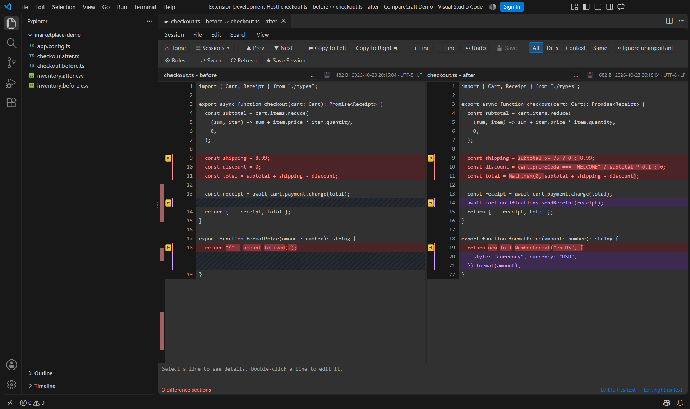

# CompareCraft for VS Code

The CompareCraft extension lets you compare files, editor text, and Git
revisions from VS Code. Text comparisons and three-way conflict resolution can
open in VS Code tabs; folder comparisons and other unsupported views open in
the CompareCraft desktop app.

## Requirements

- VS Code 1.95 or newer on a local Windows, macOS or Linux desktop.
- The CompareCraft desktop app, installed separately and from the same release
  line as the extension.
- A trusted local workspace. Remote SSH, WSL, Dev Containers, virtual
  workspaces and browser-only VS Code are not supported.
- Git installed and available to VS Code for Git comparisons and conflict
  resolution.

## Install

1. Install the [CompareCraft desktop app](https://github.com/Antebios/comparecraft/releases).
2. Download the CompareCraft VS Code `.vsix` file from the
   [CompareCraft releases page](https://github.com/Antebios/comparecraft/releases).
3. In VS Code, open **Extensions** (`Ctrl+Shift+X`), select **…**, choose
   **Install from VSIX…**, and select the downloaded file.
4. If the desktop app is installed in a non-standard location, run
   **CompareCraft: Locate Desktop Executable…** from the Command Palette
   (`Ctrl+Shift+P`).

The extension and desktop app are separate installations. The extension
currently installs from a VSIX; it is not listed on the Visual Studio
Marketplace or Open VSX.

## Compare files and folders

In the Explorer, select two files or two folders, right-click, and choose
**CompareCraft > Compare Selected…**. If you select only one item, the extension
asks you to choose the other side. You can also select a left item first with
**Select Left File or Folder**, then compare another item with
**Compare with Selected Left…**.

Other useful commands are available from the Explorer or Command Palette:

| Command | What it does |
| --- | --- |
| **Compare File With…** | Choose another file to compare with the selected or active file. |
| **Compare Folder With…** | Choose another folder to compare with the selected folder. |
| **Compare Parent Folder With…** | Compare a selected file's parent folder with a chosen folder. |
| **Compare Selected in VS Code** | Open a supported comparison in a VS Code tab. |
| **Compare Selected in Desktop App** | Open the comparison in the desktop app. |

Folder Compare, Folder Sync and Folder Merge run in the desktop app. The
extension asks before opening it.

## Compare editor text

Right-click in an editor to compare the current selection or document:

- **Compare with Saved** compares the current editor contents with the saved
  file.
- **Select Text as Left**, followed by **Compare Text with Left**, compares
  editor text without first saving it.
- **Compare Selection with Clipboard** compares the selection, or the whole
  document if nothing is selected, with clipboard text.
- **Open Active Diff in Desktop App** opens both sides of a VS Code diff editor
  in the desktop app.

Your unsaved editor contents are included, but the extension never saves them
automatically. In desktop mode, unsaved text is opened as a read-only copy.

## Compare Git versions and resolve conflicts

The **CompareCraft > Git** commands let you compare a file with **HEAD**, compare
the Git index with the working tree, compare **HEAD** with the index, or choose
a recent revision.

For a supported Git conflict, choose **Resolve Conflict in VS Code** to open a
three-way merge with Current, Base, Incoming and an editable Result. You can
instead choose **Resolve Conflict in Desktop App**.

The extension does not commit, continue, skip or abort a merge, rebase or
cherry-pick. You can stage a resolved file with **Stage Resolved Conflict…**,
which asks for confirmation. Binary, symbolic-link, submodule and
modify/delete or rename conflicts must be resolved with Git directly.

## Embedded views and editing

Text comparisons are editable. Save from the CompareCraft tab to write changes
through VS Code; saved files, Git revisions and clipboard text are read-only.
If the file changed elsewhere after loading, saving is refused to avoid
overwriting newer work. Reload the side before saving again.

Table comparisons are read-only and support CSV/TSV files up to 64 MB:

Binary (Hex), Picture and Patch views are read-only in VS Code. Unsupported
views open in the desktop app after confirmation.

## Settings

Set these under **User** settings, not workspace settings:

| Setting | Default | Description |
| --- | --- | --- |
| `comparecraft.defaultMode` | `embedded` | Open supported comparisons in a VS Code tab (`embedded`) or the desktop app (`desktop`). Commands explicitly named “in Desktop App” always use the desktop app. |
| `comparecraft.desktopPath` | Empty | Executable path for a portable or custom desktop installation. Usually set with **Locate Desktop Executable…**. |
| `comparecraft.backendPath` | Empty | Advanced override for the helper used by embedded views. Normally detected automatically. |

The extension's comparison preferences are separate from the desktop app's
settings.

## Troubleshooting

Open **View > Output** and choose **CompareCraft** to see launch messages and
errors.

| Problem | Try this |
| --- | --- |
| The desktop app is not detected | Install it, or run **CompareCraft: Locate Desktop Executable…**. |
| An embedded comparison fails to open | Run **CompareCraft: Check Embedded Backend** from the Command Palette. Make sure the app and extension are from the same release line. |
| Commands are unavailable | Trust the workspace and use a local desktop workspace. |
| Saving is refused | Reload after external file changes. For a merge result, save or revert edits in the normal editor and refresh the merge tab. |
| Git commands do not use CompareCraft in a terminal | Run **Configure as Git Merge/Diff Tool…** and confirm the setup. Use **Remove Git Tool Configuration…** before uninstalling to restore prior Git settings. |

For help, report issues in the
[CompareCraft issue tracker](https://github.com/Antebios/comparecraft/issues).
Include your operating system and app and VS Code versions; review logs for
private paths or content before sharing them.
