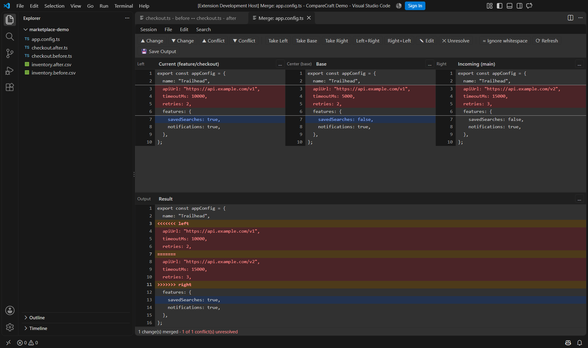
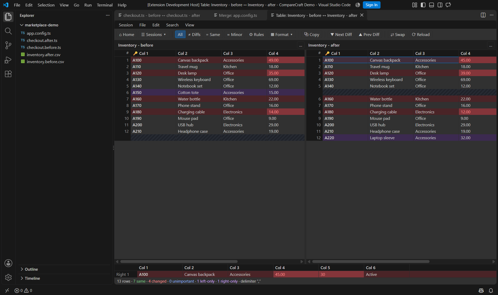

# CompareCraft for VS Code

Compare files, selected text, and Git revisions side by side without leaving
VS Code. Edit text comparisons, explore CSV differences, and resolve three-way
merge conflicts in a CompareCraft tab that follows your VS Code theme.

Prefer a separate window? Open comparisons in the CompareCraft desktop app.
Folder comparisons always use the desktop app.

**Requires the [CompareCraft desktop app](https://github.com/Antebios/comparecraft/releases),
installed separately.**

## Screenshots

### Compare and edit files without leaving VS Code

### Resolve three-way conflicts in an embedded merge tab

### Compare CSV data side by side

## Requirements

- VS Code 1.95 or newer on local Windows, macOS, or Linux desktop.
- An installed [CompareCraft desktop app](https://github.com/Antebios/comparecraft/releases)
  from the same release line as the extension.
- A trusted local workspace. Remote SSH, WSL, Dev Containers, browser-only hosts,
  and virtual workspaces are not supported.
- Git installed and available to VS Code for Git comparisons and conflict resolution.

## Get started

1. Install the CompareCraft desktop app. Standard installations are detected
  automatically. For a portable or custom installation, run **CompareCraft:
  Locate Desktop Executable...** from the Command Palette.
2. Select two files in Explorer, right-click, and choose **CompareCraft >
  Compare Selected...**.
3. Review the differences in a CompareCraft tab. Text files can be edited and
  saved directly; images, binary files, and tables open read-only.

To compare folders, use **CompareCraft: Compare Folder With...**. You will be
asked before the desktop app opens.

## Compare files and folders

Right-click resources in Explorer, a text editor, or an editor tab and open the
**CompareCraft** submenu. All commands are also available in the Command Palette.

| Command | Behavior |
| --- | --- |
| Compare Selected... | Compares two selected files or folders. With one selected item, asks for the other. |
| Compare Selected in VS Code | Opens a file comparison in a VS Code tab. |
| Compare Selected in Desktop App | Opens a comparison in the desktop app. |
| Select Left File or Folder | Remembers an item to compare later. |
| Compare with Selected Left... | Compares the current item with your remembered selection of the same type. |
| Clear Left Selections | Clears both remembered selections. |
| Compare File With... | Picks another file to compare with the selected or active file. |
| Compare Folder With... | Picks another folder to compare with the selected folder. |
| Compare Parent Folder With... | Compares the selected file's parent directory against a chosen folder. |
| Open Desktop App | Opens CompareCraft's home view directly. |

Compare two different files or two different folders, not a file against a
folder. Remembered selections last until cleared or VS Code restarts.

## Compare editor text

Right-click inside an editor (including untitled ones) and open **CompareCraft**:

| Command | Behavior |
| --- | --- |
| Compare with Saved | Compares your unsaved edits with the saved file. The saved side is read-only. |
| Select Text as Left | Remembers selected text, or the whole document when nothing is selected. |
| Compare Text with Left | Compares selected text or the whole document with the remembered text. |
| Compare Selection with Clipboard | Compares selected text or the whole document with your clipboard. |
| Open Active Diff in Desktop App | In a VS Code diff editor (including Git diffs), opens the same two sides in CompareCraft. Available from the diff editor's **...** menu. |

**Your unsaved edits are included and never saved automatically.** In desktop
mode, unsaved text opens as a read-only copy labeled *(unsaved buffer)*; edits
to that copy cannot be saved back to VS Code. Save or revert unsaved files
before comparing their folders.

## Git comparisons and conflicts

Git commands are in the **CompareCraft > Git** submenu for files (Explorer and
editor) and in the **CompareCraft** submenu of the Source Control view's context
menu for changed files:

| Command | Behavior |
| --- | --- |
| Compare with HEAD | Last commit vs working file (or its unsaved buffer). |
| Compare Index with Working Tree | Staged version vs working file. |
| Compare HEAD with Index | Last commit vs staged version. |
| Compare with Revision... | Pick a recent commit and compare it with the working file. |
| Resolve Conflict in VS Code | Opens Current, Base, Incoming, and an editable Result in a three-way merge tab. |
| Resolve Conflict in Desktop App | The same three-way merge in the desktop app. |
| Stage Resolved Conflict... | Stages the resolved file after confirmation. |
| Configure as Git Merge/Diff Tool... | Opt-in setup so `git mergetool` / `git difftool` in a terminal use CompareCraft. |
| Remove Git Tool Configuration... | Restores the Git settings changed by the command above. |

Only the **Result** is saved in a merge tab; Current, Base, and Incoming are
read-only. Save or revert unsaved edits in the file's normal editor before
resolving its conflict.

Conflict labels describe the actual operation instead of "ours/theirs". During a
**merge**, Current is your branch and Incoming is the branch being merged. During
a **rebase**, Current is the new base plus commits already replayed, and Incoming
is the commit being replayed. Cherry-pick, revert, and stash-apply conflicts are
also supported.

Safety rules:

- The extension **never** commits, continues, skips, or aborts a merge, rebase,
  or cherry-pick. After staging, continue from Source Control or the terminal.
- Staging always asks for confirmation, warns about leftover conflict markers,
  and is refused if the Git conflict state changed while you were resolving it.
- Binary, symbolic link, submodule, and modify/delete (or rename) conflicts are
  refused with an explanation. Resolve those with Git directly (`git add`/`git rm`).

Git settings change only when you run **Configure as Git Merge/Diff Tool...**
and confirm. To undo that setup, run **Remove Git Tool Configuration...** before
uninstalling the extension.

## Editing and saving

- Text comparisons include your current VS Code edits. Save in the CompareCraft
  tab to save the corresponding file through VS Code. Saved versions, Git
  revisions, and clipboard text are read-only.
- If a file changes elsewhere, saving is refused to prevent overwriting newer
  work. Reload the side first. For merge tabs, save or revert edits in the normal
  editor, then click **Refresh** before saving the result.
- Switching tabs keeps your comparison and merge work intact.
- Closing an unsaved tab offers **Restore Comparison** or **Open as Untitled**
  so you can recover your edits. Reloading the window also restores open tabs.

## Settings

| Setting | Default | Meaning |
| --- | --- | --- |
| `comparecraft.defaultMode` | `embedded` | Open comparisons in a VS Code tab (`embedded`) or the desktop app (`desktop`). Commands named "in Desktop App" always use the desktop app. |
| `comparecraft.desktopPath` | empty | Path to the desktop executable for a custom installation. Usually set with **Locate Desktop Executable...**. |
| `comparecraft.backendPath` | empty | Advanced: override the path to the helper used for VS Code tabs. Normally detected automatically. |

Executable paths must be set in your **User** settings, not workspace settings.
Comparison preferences inside VS Code are separate from the desktop app's settings.

## Troubleshooting

Open **View > Output** and pick **CompareCraft** for launch commands, helper
start-up, and errors.

| Symptom | What to do |
| --- | --- |
| "CompareCraft is not installed" | Install the desktop app, or run **Locate Desktop Executable...** for portable/AppImage/custom installs. |
| A comparison tab fails to open | Run **CompareCraft: Check Embedded Backend** from the Command Palette. Update the desktop app to match your extension version, then reopen the comparison. |
| A view offers to open in the desktop app | Your installed app does not support that view inside VS Code yet. Update CompareCraft. |
| Commands are missing or disabled | Trust the workspace; remote and virtual workspaces are not supported. |
| Save in a CompareCraft tab is refused | The file changed in an editor or on disk after the tab loaded it, or (merge tabs) the result file has unsaved edits elsewhere. Save or revert, click **Refresh**, then save. |
| Resolve Conflict is refused | Binary, symbolic link, submodule, and modify/delete conflicts must be resolved with Git directly. |
| Git's terminal tools do not use CompareCraft | Run **Configure as Git Merge/Diff Tool...** for the repository, and rerun it if you move the desktop app. |

## Known limitations

- Local desktop workspaces only; remote and virtual workspaces are not supported.
- Folder comparison, sync, and merge open in the desktop app, after confirmation.
- Binary (Hex), CSV/TSV (Table), Picture, and Patch views are read-only inside
  VS Code. Table and Picture views support files up to 64 MB.
- Unsaved files, Git revisions, and clipboard content are always compared as text.
- Sessions, reports, backups, and Open With are not available inside VS Code.

## Support

Report problems or request features in the
[CompareCraft issue tracker](https://github.com/Antebios/comparecraft/issues).
Include your operating system, VS Code version, CompareCraft version, and the
relevant error from the **CompareCraft** Output channel. Review logs for private
file paths or content before sharing them.
