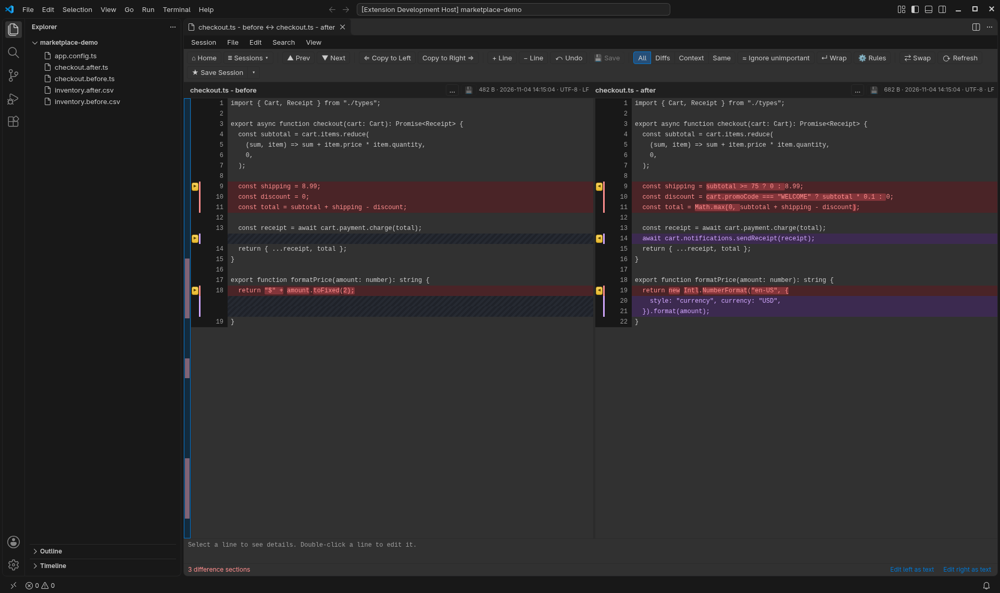
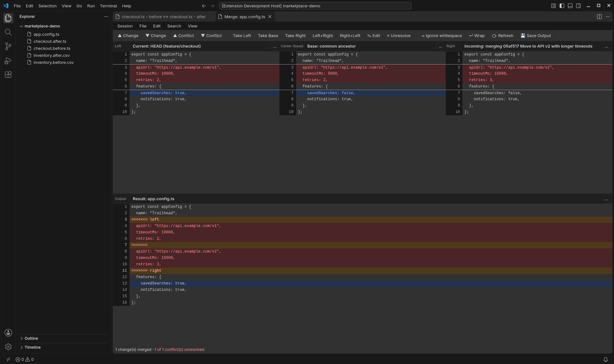
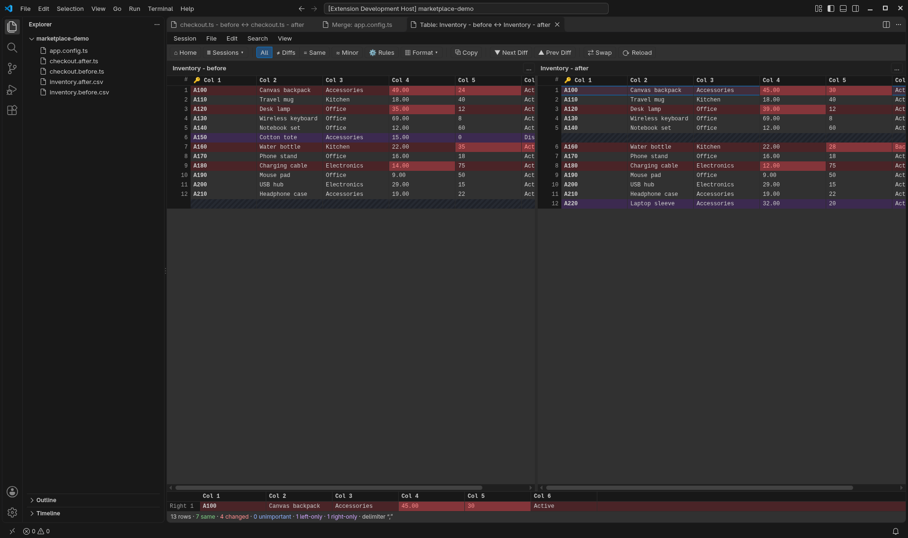
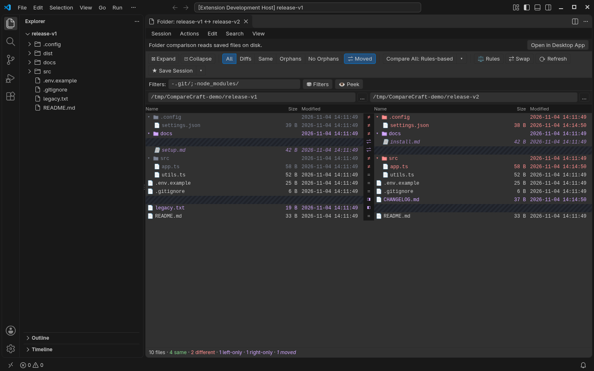
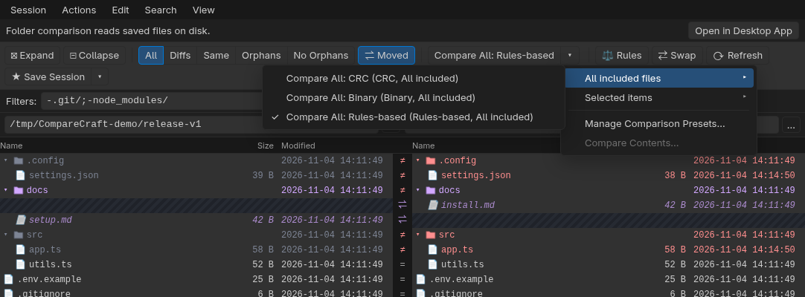
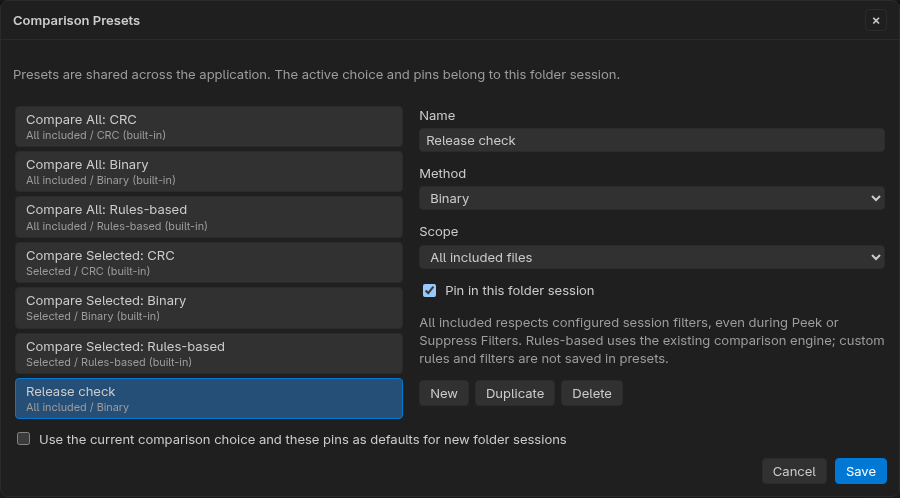
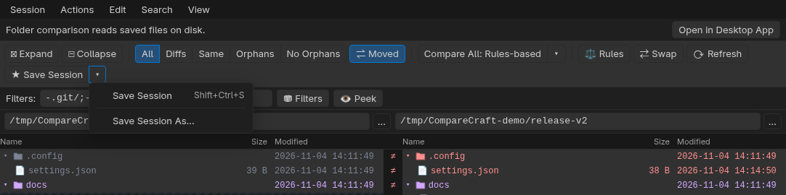
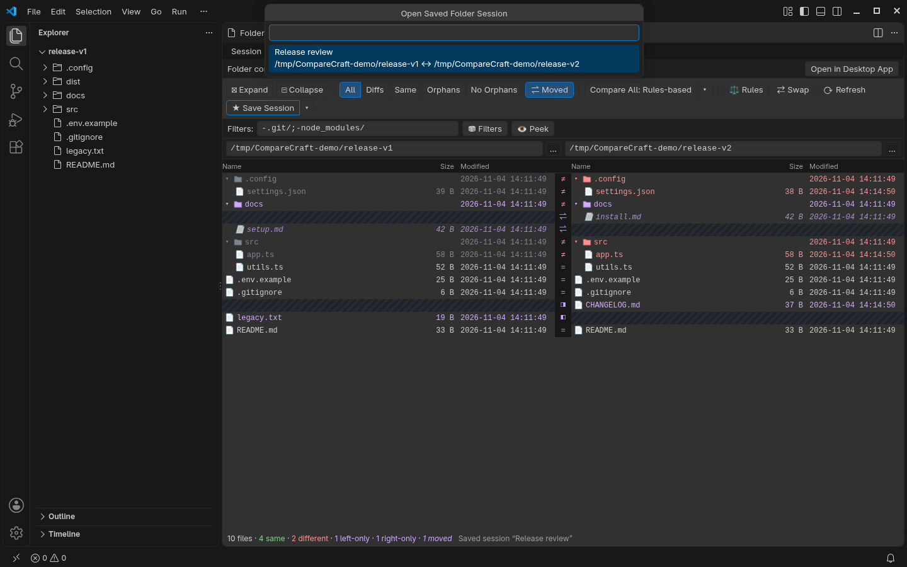
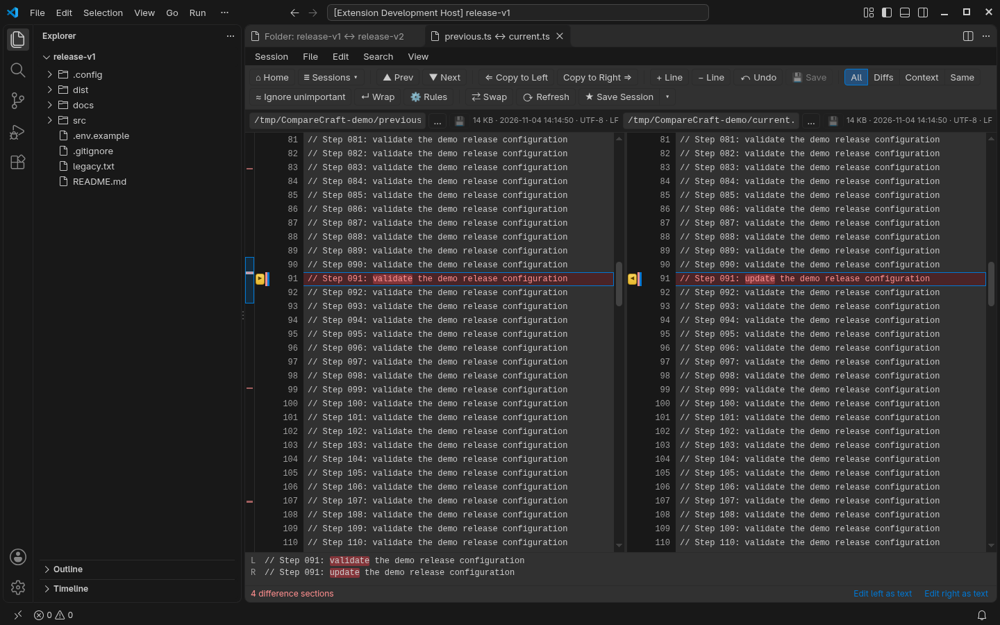

# CompareCraft for VS Code

Compare files, local folders, selected text, and Git revisions side by side without leaving
VS Code. Edit text comparisons, explore CSV differences, and resolve three-way
merge conflicts in a CompareCraft tab that follows your VS Code theme.

CompareCraft works in VS Code on your computer, in remote windows (Remote - SSH,
WSL, Dev Containers), in Restricted Mode, in virtual workspaces and in VS Code for
the Web. See [Where CompareCraft works](#where-comparecraft-works).

Prefer a separate window? Open comparisons in the optional
[CompareCraft desktop app](https://github.com/Antebios/comparecraft/releases).
Folder panels inside VS Code are comparison-only; use the desktop app for folder operations.

### Folder comparison roadmap

The
[folder comparison roadmap](../../docs/vscode-extension/folder-comparison-roadmap.md)
documents the comparison-only folder panels and future full folder workflows.

## Screenshots

### Compare and edit files without leaving VS Code

### Resolve three-way conflicts in an embedded merge tab

### Compare CSV data side by side

### Compare local folders in a VS Code tab

Folder results come from saved disk contents. Folders are colored separately on
each side by what they contain, files moved or renamed between the sides are
marked **⇌**, and items your `.gitignore` files ignore are left out. Use
**Open in Desktop App** for folder operations.

### Choose a comparison method and scope

Choosing a preset changes the main button; click that button to run it.

Named presets are shared across extension folder panels; pins belong to the
current folder session. Extra pins appear under **More**.

### Save and reopen a named folder session

Use the main button to save, or its arrow to save a copy under another name.

Run **CompareCraft: Open Saved Folder Session...** from the Command Palette to
find your saved folder sessions.

### Locate text changes with the difference map

The map at the left shows changes throughout the file and highlights the
currently visible lines.

## Requirements

- VS Code 1.95 or newer.
- Nothing else for comparisons in VS Code: the extension package for your
  platform (Windows, macOS, Linux and Alpine Linux; x64 and Arm64) includes
  CompareCraft's comparison helper. On other platforms CompareCraft compares
  files with its WebAssembly engine; folder comparisons there need the desktop
  app's helper.
- Optional: the [CompareCraft desktop app](https://github.com/Antebios/comparecraft/releases)
  to open comparisons in their own window and for folder operations.
- Git, for Git comparisons and conflict resolution.

## Where CompareCraft works

| Where | Comparisons in VS Code | Folder comparisons | Desktop app | Git commands |
| --- | --- | --- | --- | --- |
| VS Code on your computer | Yes | Yes | Yes | Yes |
| Restricted Mode (a folder you haven't trusted) | Read-only | Yes | Trust the folder first | Trust the folder first |
| Remote - SSH, WSL, Dev Containers | Yes, on the remote computer | Yes, on the remote computer | No | Yes, on the remote computer |
| Virtual workspaces (for example a GitHub repository opened without cloning) | Yes; saved where the provider allows it | Yes, from a temporary copy | No | No |
| VS Code for the Web (vscode.dev, github.dev) | Yes, with a built-in WebAssembly engine | No | No | No |

- **Restricted Mode:** CompareCraft compares read-only. Saving, Git commands (a
  repository's Git configuration can run programs) and the desktop app wait until
  you trust the folder (**Workspaces: Manage Workspace Trust**); open CompareCraft
  tabs update when you do.
- **Remote windows:** CompareCraft runs on the remote computer, next to your files,
  with the helper for that computer's platform. The desktop app runs on your local
  computer and can't open remote files, so comparisons always open in VS Code.
  **Show in File Manager** becomes **Reveal in Explorer View**.
- **Virtual workspaces:** files are read and saved through VS Code. To compare two
  folders, CompareCraft first copies them to a temporary local folder (up to 20,000
  files and 512 MB in total) and compares the copies; refreshing copies them again.
  Git commands need a working tree on disk: clone the repository.
- **VS Code for the Web:** text, binary (Hex), CSV/TSV (Table) and picture
  comparisons run in your browser with CompareCraft's WebAssembly engine. Folder
  comparisons, Git commands and the desktop app need VS Code desktop.

When something isn't available, the command explains why instead of failing.

## Get started

1. Select two files in Explorer, right-click, and choose **CompareCraft >
  Compare Selected...**.
2. Review the differences in a CompareCraft tab. Text files can be edited and
  saved directly; images, binary files, and tables open read-only.
3. Optional: install the CompareCraft desktop app to open comparisons in their
  own window. Standard installations are detected automatically. For a portable
  or custom installation, run **CompareCraft: Locate Desktop Executable...** from
  the Command Palette.

To compare folders, use **CompareCraft: Compare Folder With...**, or select two
folders and choose **Compare Selected in VS Code**. If an older helper (from an
older desktop app, or set in `comparecraft.backendPath`) lacks folder support,
CompareCraft offers the desktop app instead; update CompareCraft to compare
folders in VS Code.

## Compare files and folders

Right-click resources in Explorer, a text editor, or an editor tab and open the
**CompareCraft** submenu. All commands are also available in the Command Palette.

| Command | Behavior |
| --- | --- |
| Compare Selected... | Compares two selected files or folders. With one selected item, asks for the other. |
| Compare Selected in VS Code | Opens a file or local folder comparison in a VS Code tab. |
| Compare Selected in Desktop App | Opens a comparison in the desktop app. |
| Select Left File or Folder | Remembers an item to compare later. |
| Compare with Selected Left... | Compares the current item with your remembered selection of the same type. |
| Clear Left Selections | Clears both remembered selections. |
| Compare File With... | Picks another file to compare with the selected or active file. |
| Compare Folder With... | Picks another folder to compare with the selected folder. |
| Compare Parent Folder With... | Compares the selected file's parent directory against a chosen folder. |
| Open Desktop App | Opens CompareCraft's home view directly. |
| Open Saved Folder Session... | Opens a named VS Code folder session from a Quick Pick. |

Compare two different files or two different folders, not a file against a
folder. Remembered selections last until cleared or VS Code restarts.

To replace a side of an open comparison, hold **Shift** and drag a file or
folder from the Explorer or an editor tab onto that side, or onto its path box.
Dropping two items replaces both sides. VS Code doesn't share the paths of files
dropped from the system file manager with extensions, so for those use the
**…** button or the Explorer commands above.

## Compare editor text

Right-click inside an editor (including untitled ones) and open **CompareCraft**:

| Command | Behavior |
| --- | --- |
| Compare with Saved | Compares your unsaved edits with the saved file. The saved side is read-only. |
| Select Text as Left | Remembers selected text, or the whole document when nothing is selected. |
| Compare Text with Left | Compares selected text or the whole document with the remembered text. |
| Compare Selection with Clipboard | Compares selected text or the whole document with your clipboard. |
| Open Active Diff in Desktop App | In a VS Code diff editor (including Git diffs), opens the same two sides in CompareCraft. Available from the diff editor's **...** menu. |

**Your unsaved edits are included and never saved automatically.** In desktop
mode, unsaved text opens as a read-only copy labeled *(unsaved buffer)*; edits
to that copy cannot be saved back to VS Code. Save or revert unsaved files
before comparing their folders in the desktop app.

## Folder comparisons inside VS Code

- Inspect the shared folder tree and gutter, select files, configure inclusion
  and display filters, use CRC/Binary/Rules-based comparison presets, and refresh.
- Folder names and icons are colored separately on each side by what the folder
  contains (newer, different or orphan files); hover over a folder for details, or
  choose **View > Legend**.
- **Respect .gitignore files** (Session Settings > Other Filters) leaves out items
  either side's `.gitignore` ignores, and `.git` folders. **Detect moved and
  renamed files** (Session Settings > Comparison) pairs identical left-only and
  right-only files and marks them **⇌**; toggle **⇌ Moved** on the toolbar to hide
  them. Both are on by default. With an older helper (from CompareCraft 0.5.0
  or earlier, or set in `comparecraft.backendPath`) they are shown disabled and
  a notice suggests updating.
- Folder comparisons read **saved files on disk**. Unsaved editor buffers are
  shown in child text comparisons but never treated as saved-disk gutter results.
  No files are automatically saved.
- Open file rows in editable text comparisons or read-only binary/table/picture
  views. Saved changes and reloads re-evaluate the originating pair from disk;
  refreshing/changing the parent invalidates old child results.
- Save named folder sessions from the folder panel; reopen them with
  **CompareCraft: Open Saved Folder Session...**. Presets and sessions are stored
  separately from the desktop app. Window reload restores paths and options and
  recomputes the tree, rather than restoring stale comparison results.
- Copy, move, delete, rename, touch, synchronization, folder merge, snapshots,
  reports and external Open With are not available in folder panels. Use
  **Open Folder Comparison in Desktop App** explicitly for full folder workflows.

The helper must advertise protocol-v1 `folder.compare`, `folder.compareItems`
and `file.quickCompare`. Protocol 1 alone does not imply folder support.
In remote windows, folders are compared on the remote computer. In virtual
workspaces they are compared from temporary copies (see
[Where CompareCraft works](#where-comparecraft-works)); VS Code for the Web
can't compare folders.

## Git comparisons and conflicts

Git commands are in the **CompareCraft > Git** submenu for files (Explorer and
editor) and in the **CompareCraft** submenu of the Source Control view's context
menu for changed files:

| Command | Behavior |
| --- | --- |
| Compare with HEAD | Last commit vs working file (or its unsaved buffer). |
| Compare Index with Working Tree | Staged version vs working file. |
| Compare HEAD with Index | Last commit vs staged version. |
| Compare with Revision... | Pick a recent commit and compare it with the working file. |
| Resolve Conflict in VS Code | Opens Current, Base, Incoming, and an editable Result in a three-way merge tab. |
| Resolve Conflict in Desktop App | The same three-way merge in the desktop app. |
| Stage Resolved Conflict... | Stages the resolved file after confirmation. |
| Configure as Git Merge/Diff Tool... | Opt-in setup so `git mergetool` / `git difftool` in a terminal use CompareCraft. |
| Remove Git Tool Configuration... | Restores the Git settings changed by the command above. |

Only the **Result** is saved in a merge tab; Current, Base, and Incoming are
read-only. Save or revert unsaved edits in the file's normal editor before
resolving its conflict.

Conflict labels describe the actual operation instead of "ours/theirs". During a
**merge**, Current is your branch and Incoming is the branch being merged. During
a **rebase**, Current is the new base plus commits already replayed, and Incoming
is the commit being replayed. Cherry-pick, revert, and stash-apply conflicts are
also supported.

Safety rules:

- The extension **never** commits, continues, skips, or aborts a merge, rebase,
  or cherry-pick. After staging, continue from Source Control or the terminal.
- Staging always asks for confirmation, warns about leftover conflict markers,
  and is refused if the Git conflict state changed while you were resolving it.
- Binary, symbolic link, submodule, and modify/delete (or rename) conflicts are
  refused with an explanation. Resolve those with Git directly (`git add`/`git rm`).

Git settings change only when you run **Configure as Git Merge/Diff Tool...**
and confirm. To undo that setup, run **Remove Git Tool Configuration...** before
uninstalling the extension.

## Text comparisons

- Long lines wrap by default when VS Code's **Editor: Word Wrap**
  (`editor.wordWrap`) setting is on (any value other than `off`). Turn wrapping
  on or off for one tab with **↵ Wrap**, **View > Word Wrap** or `Alt+Z`.
- Drag across text to select part of a line or several lines, then use **Copy to
  Left** / **Copy to Right** (`Ctrl+L` / `Ctrl+R`) to replace the matching text on
  the other side, or `Ctrl+C` to copy it. Dragging past the edge of a pane scrolls it.

## Keyboard shortcuts

While a CompareCraft tab has focus, its own shortcuts take precedence over
VS Code's: for example `Ctrl+R` copies to the right instead of opening a recent
folder, `F5` refreshes instead of starting debugging, and `Ctrl+N` / `Ctrl+P`
move between differences. Keys the current view doesn't use still reach VS Code,
and `Ctrl+Shift+P` always opens the Command Palette. On macOS, `Ctrl` in
CompareCraft shortcuts is `Cmd`.

## Editing and saving

- Text comparisons include your current VS Code edits. Save in the CompareCraft
  tab to save the corresponding file through VS Code. Saved versions, Git
  revisions, and clipboard text are read-only.
- If a file changes elsewhere, saving is refused to prevent overwriting newer
  work. Reload the side first. For merge tabs, save or revert edits in the normal
  editor, then click **Refresh** before saving the result.
- Switching tabs keeps your comparison and merge work intact.
- Closing an unsaved tab offers **Restore Comparison** or **Open as Untitled**
  so you can recover your edits. Reloading the window also restores open tabs.

## Settings

| Setting | Default | Meaning |
| --- | --- | --- |
| `comparecraft.defaultMode` | `embedded` | Open comparisons in a VS Code tab (`embedded`) or the desktop app (`desktop`). Commands named "in Desktop App" always use the desktop app. |
| `comparecraft.desktopPath` | empty | Path to the desktop executable for a custom installation. Usually set with **Locate Desktop Executable...**. |
| `comparecraft.backendPath` | empty | Advanced: a `comparecraft-backend` helper to use instead of the one bundled with the extension (or the desktop app's). Without any helper, CompareCraft compares with its WebAssembly engine. |

Executable paths must be set in your **User** settings, not workspace settings.
Comparison preferences inside VS Code are separate from the desktop app's settings.
Text comparisons wrap long lines when VS Code's `editor.wordWrap` setting is on.

## Troubleshooting

Open **View > Output** and pick **CompareCraft** for launch commands, helper
start-up, and errors.

| Symptom | What to do |
| --- | --- |
| "CompareCraft is not installed" | Only commands that open the desktop app need it. Install the desktop app, or run **Locate Desktop Executable...** for portable/AppImage/custom installs. |
| A comparison tab fails to open | Run **CompareCraft: Check Embedded Backend** from the Command Palette. It reports which engine compares here (the helper bundled with the extension, the desktop app's helper or the WebAssembly engine), where it runs, and any problem. |
| Folder comparison says it needs the helper | The extension package for this platform includes it; reinstall the extension, install the desktop app, or set `comparecraft.backendPath`. VS Code for the Web can't compare folders. |
| A view offers to open in the desktop app | Your installed app does not support that view inside VS Code yet. Update CompareCraft. |
| **Respect .gitignore files** or **Detect moved and renamed files** is disabled | The installed desktop app is older than the extension. Update CompareCraft to use these options. |
| A CompareCraft shortcut runs a VS Code command too, or a VS Code shortcut does nothing in a CompareCraft tab | CompareCraft handles the keys its current view uses (see [Keyboard shortcuts](#keyboard-shortcuts)). Click outside the tab, or use the Command Palette (`Ctrl+Shift+P`). |
| A command says it isn't available here | See [Where CompareCraft works](#where-comparecraft-works). In Restricted Mode, trust the folder to save, use Git or open the desktop app. |
| Save in a CompareCraft tab is refused | The file changed in an editor or on disk after the tab loaded it, or (merge tabs) the result file has unsaved edits elsewhere. Save or revert, click **Refresh**, then save. |
| Resolve Conflict is refused | Binary, symbolic link, submodule, and modify/delete conflicts must be resolved with Git directly. |
| Git's terminal tools do not use CompareCraft | Run **Configure as Git Merge/Diff Tool...** for the repository, and rerun it if you move the desktop app. |

## Known limitations

- The desktop app can't be used from remote windows, virtual workspaces or
  VS Code for the Web; comparisons open in VS Code there. See
  [Where CompareCraft works](#where-comparecraft-works).
- Folder sync and folder merge require the desktop app; embedded folders are comparison-only.
- Binary (Hex), CSV/TSV (Table), Picture, and Patch views are read-only inside
  VS Code. Table and Picture views support files up to 64 MB.
- Unsaved files, Git revisions, and clipboard content are always compared as text.
- Drag and drop works with Shift+drag from the VS Code Explorer and editor tabs
  only. Some VS Code versions (1.140 and later) block Shift+drag into webviews
  ([microsoft/vscode#339278](https://github.com/microsoft/vscode/issues/339278));
  use the **…** button until that is fixed.
- Named folder sessions are supported; reports, backups and external Open With
  remain desktop features.

## Feature locations

### Text Compare difference map

Open a Text Compare in a VS Code tab. The narrow **difference map** is at the far left of the text panes. It marks where differences occur; click a mark to jump to it, or click elsewhere in the strip to move both panes to that location. A viewport highlight tracks the visible area. See the [Text Compare manual](../../docs/manual/text-compare.md#the-window).

### Save and reopen sessions

In an embedded Text Compare tab, use **★ Save Session** on the toolbar. The first save asks for a name; later saves update that session. Use the adjacent **▾** arrow or **Session > Save Session As…** to save a copy under another name. If that name belongs to a different saved session, CompareCraft asks before replacing it. Use the toolbar's **Sessions** menu to reopen a saved Text Compare. Session data is stored in this VS Code installation's extension global state and is available across workspaces. See the [Sessions manual](../../docs/manual/sessions.md#save-a-session).

### Folder sorting and comparison progress

From VS Code, choose **CompareCraft > Compare Selected…** for two folders to open a comparison tab in embedded mode. Explicit desktop commands open the desktop app instead. Embedded folder comparisons show an indeterminate progress indicator; the desktop app also reports scanning and completed/total file counts while comparing.

To put dot-prefixed folders and files first for one comparison, choose **Session > Session Settings… > Handling > Sorting** and select **First**; **Use global default** follows the global option. In the desktop app, set **Tools > Options > Colors, Fonts > Folder views > Dot-prefixed names first** for the global default. VS Code comparison preferences are stored separately from desktop settings. See [Folder Compare: Name sorting](../../docs/manual/folder-compare.md#name-sorting).

## Saved sessions

The extension stores named and recent sessions in VS Code global state, with separate libraries for folder and file comparisons.
Recent entries are refreshed for matching paths and limited to 50 per library.
Automatic recent-session updates do not overwrite named sessions. Names are
matched case-insensitively, and locked sessions must be unlocked or saved under
a different name before changing their saved paths or settings.

## Support

Report problems or request features in the
[CompareCraft issue tracker](https://github.com/Antebios/comparecraft/issues).
Include your operating system, VS Code version, CompareCraft version, and the
relevant error from the **CompareCraft** Output channel. Review logs for private
file paths or content before sharing them.
